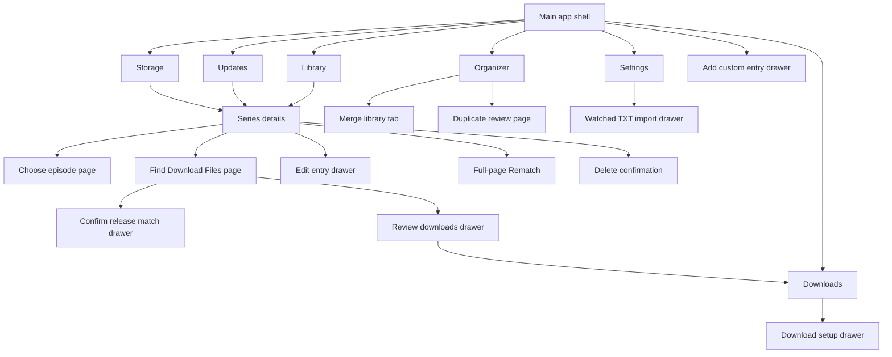

# All Feature and their Navigation

Anime Vault — current feature inventory and navigation reference for UI redesign.

**Navigation update, 12 November 2026:** Each main tab remembers its open page
during the current session. Returning to Library restores its series details;
returning to Updates restores its open release-discovery page. Back and Close
return to the parent page. Global Library search and collection shortcuts open
the Library results directly. See NAVIGATION_MEMORY_AND_COMPACT_HEADINGS.md.

**Update review:** Library's New seasons and episodes posters now route through
Updates to View changes. Back returns to the Updates overview. Ordinary Library
cards retain anime details. Full-page Back controls and breadcrumbs share one row.

**Shell update:** Maximize fills the Windows work area with the taskbar visible;
F11 enters/leaves fullscreen. Connectivity and indexed-count status now appear
beneath All anime instead of in a global footer. The rightmost three-line menu
retains its existing commands. Disk usage remains in the header and Storage.

**Nested breadcrumb update:** Workflow breadcrumbs now include the full anime
context and intermediate pages, e.g. Library / Anime / Choose episode / Find
Download Files. Tab switching retains the path; Back shortens it; returning to
the Library root resets it. Drawers also show this shared navigation header.
See BREADCRUMB_NAVIGATION_HISTORY.md.

**Menus/update review:** The top-right navigator and poster/list context menus
use the shared Vault menu design. Context commands reuse existing Details actions
and preserve Select. View changes reads fresh saved records on open and offers
Refresh data for an explicit scoped AniList check, with cached/error/empty states.
See VAULT_MENUS_AND_UPDATE_REVIEW.md.

**Update-review follow-up:** Open details beside Refresh data navigates to the
same anime and Back returns to View changes. Episode notifications distinguish
timestamp-confirmed aired episodes from future scheduled episodes. A shared
bottom-edge progress bar remains visible across tab changes while refreshes run.
See UPDATE_DETAILS_EPISODE_TIMING_AND_PROGRESS.md.

**Reviewed:** 11 November 2026. **Scope:** the current Python/PyQt implementation,
not every idea discussed in chat or every element in an older mockup.

This document describes what exists, where users find it, what happens when they
activate it, and what a new UI must preserve. It does not authorize new features
or changes to file handling. No application code was changed to produce it.

## Contents

1. [App structure and navigation map](#1-app-structure-and-navigation-map)
2. [Global shell and shortcuts](#2-global-shell-and-shortcuts)
3. [Library](#3-library)
4. [Series details](#4-series-details)
5. [Episode selection](#5-episode-selection)
6. [Updates](#6-updates)
7. [Organizer](#7-organizer)
8. [Merge libraries](#8-merge-libraries)
9. [Duplicate review](#9-duplicate-review)
10. [Storage](#10-storage)
11. [Downloads queue](#11-downloads-queue)
12. [Release search and download review](#12-release-search-and-download-review)
13. [Download setup and Chrome](#13-download-setup-and-chrome)
14. [Settings](#14-settings)
15. [Entry editing, rematching, import and deletion](#15-entry-editing-rematching-import-and-deletion)
16. [Background work and saved state](#16-background-work-and-saved-state)
17. [Core user journeys](#17-core-user-journeys)
18. [UI redesign preservation checklist](#18-ui-redesign-preservation-checklist)
19. [Implementation reference](#19-implementation-reference)

## 1. App structure and navigation map

### Main destinations

| Sidebar destination | Purpose | Main outgoing paths |
| --- | --- | --- |
| Library | Browse series, resume playback, release calendar, filters and selection | Series details; calendar episode availability; custom entry; batch deletion |
| Updates | New episode/release information and local library health | Details; View changes; disposition actions; metadata refresh |
| Downloads | Queue and transfer activity | Setup; download settings; manual download; file selection; queue actions |
| Organizer | Preview and organize local files | Season organization; merge tab; individual review; missing-path repair; duplicate review |
| Storage | Drive usage, collection sizes, health and reclaimable space | Details; library reclaim filter; deletion confirmation |
| Settings | Persistent configuration, import, backup and maintenance | Eight separate category pages; download setup; organizer; importer; Downloads |

The display order above differs from internal stack order. Existing stack indices
are Library 0, Organizer 1, Updates 2, Storage 3, Settings 4, Downloads 5. These
indices are implementation details, not labels for the redesigned interface.

Arrows show available journeys, not automatic redirects. For example, confirming
a download submits it to the queue; the user can then open Downloads to monitor it.

### How navigation currently works

- Main destinations share one window and the same top bar/sidebar.
- Detail and secondary workflow pages are inserted into the main content stack.
  They are not independent application windows during normal in-app navigation.
- Full workflow pages get a **Back** control. Drawers appear on the right, up to
  560 px wide, over a dimmed capture of the previous page.
- Some workflows are centered confirmation panels rather than side drawers.
- Saving, applying or cancelling a workflow returns to its previous page when
  that workflow is still the visible destination. Opening a child drawer must
  preserve its parent page, selection and results.
- Drawer **Esc** closes/cancels when allowed. Destructive or active work can
  temporarily prevent dismissal. Do not design all Close buttons as unconditional.
- Disposable episode/search pages cancel their own work when users leave;
  file organization and downloads belong to longer-lived background services.
- Sidebar switches retain existing page data; clicking a destination is not a
  request to rescan the disk or refetch all metadata.

## 2. Global shell and shortcuts

Mouse-wheel behavior: closed dropdowns and numeric editors pass the wheel to
their enclosing scrollable page without changing their values. Open dropdown
lists scroll normally. Nested lists scroll themselves, then pass the wheel to
the outer page at their top/bottom boundary. Item views use pixel scrolling;
shared workflow bodies support immediate direction reversal and reduced motion.

| Element | Action / destination | Important behavior |
| --- | --- | --- |
| Window title bar | Drag, minimize, maximize/restore, close | App name is Anime Vault; maximize and F11 full screen are different actions |
| Global title search | Goes to Library and filters titles | Typing from another destination navigates to Library |
| Search clear cross | Clears search | Visible only while text is nonempty |
| Refresh menu: Refresh and sync local files | Local indexing/refresh | No metadata API request required for this mode |
| Refresh menu: Refresh and sync with internet | Local refresh plus online synchronization | Can take longer; reports background progress |
| Add anime | Add custom entry drawer | Creates an entry with user-supplied details |
| Collection: Watching | Library filtered to Watching | Includes current counts |
| Collection: Plan to watch | Library filtered to Plan to watch | Same Library destination |
| Collection: Dropped | Library filtered to Dropped | Same Library destination |
| Collection: Watched, removed | Library filtered to removed watched records | Does not require local media files |
| Sidebar drive card / Review storage | Storage | Free/used capacity and usage indicator |
| Updates badge | Count attached to Updates navigation | Keep inside the navigation row without clipping |
| Task banner | Opens the active task's destination | Navigation is allowed; warns to keep the app open |
| Footer | Runtime information | Scan/index counts, connectivity, free space and legacy local API state where available |

### Keyboard and tray

| Input | Current result |
| --- | --- |
| Ctrl+K or Ctrl+F | Focus global search |
| F5 or Ctrl+R | Request local refresh |
| Ctrl+I | Open watched TXT importer |
| Ctrl+O | Open Organizer |
| F11 | Toggle full screen; normal maximize remains separate |
| Esc | Close supported drawers/disposable workflows; subject to active-work guards |
| Arrow keys and Enter | Navigate/activate episode blocks; standard focused controls remain keyboard operable |
| Tray: Open Anime Vault | Restore main window |
| Tray: View Library | Restore and navigate to Library |
| Tray: Storage Manager | Restore and navigate to Storage |
| Tray: Open Local API in Browser | Legacy API URL action; not a newly added streaming setting |
| Tray: Exit Completely | Request full shutdown with task/worker handling |

### Closing the application

Close behavior can be **Always ask**, **Minimize to tray**, or **Exit completely**.
The confirmation offers tray/exit, Cancel and Remember my choice. Tray mode keeps
background activity alive. Full exit stops services after their shutdown handling;
protected file operations and running workers must be respected. Do not turn close
into immediate process termination or treat tray minimization as cancellation.

## 3. Library

### Updated Details navigation

Click a poster to open the Twilight Sakura Details page. Primary Play/Resume,
its playback menu, Open folder, Edit title, Rematch, and Find Download Files remain
available. **More** opens View API JSON, Group with another series, Episode and
movie check, and Combine episode folders / Use separate seasons. Edit season
numbers remains above the full-width season table.

Below seasons, the virtual episode list shows local thumbnails, episode titles/
descriptions, and recorded playback dates. Use the release selector to narrow
the list. Click a row's Play/Resume area, or press Enter on the selected row, to
play it. Full descriptions are available on hover. Choose episode still opens
the original episode-block page. See `DETAIL_SCREEN_REDESIGN.md` for cache,
metadata-matching and lifecycle details.

Home uses the Twilight Sakura design from `Home Library Screen`. Its capsule
header links all six destinations; Quick Find retains search/clear/Ctrl+K. The
storage chip opens Storage. The actions menu retains Add anime, watched TXT import,
all collection shortcuts and local/internet Refresh. No profile/avatar is present.

Posters open details normally. To batch-select, use **Home actions → Select
multiple anime** (double-check icon), **right-click a poster → Select**, or Space
on a focused poster. Checkboxes then appear in both poster and compact views;
clicking a poster toggles selection. **Clear Selection** hides the checkboxes again.
Existing batch actions remain available. The schedule displays one Monday–Sunday
row: a title for one release, a count for multiple releases, and themed clickable
hover previews for every entry. Previous/next schedule weeks, sort/filter choices,
compact view and new-release cards are retained. Calendar/poster transfer badges
reuse the current download queue; Series DL means a series transfer, not verified
availability of the particular airing episode.

App-launched VLC/MPV sessions provide real playback position, remaining time and
resume. Space toggles the owned player while the app is active, except inside text
and interactive controls. Unsupported players retain normal launch behavior with
unavailable timing. Progress persists by Episode ID through path changes. Full
scope and checks: `HOME_LIBRARY_REDESIGN.md`.

### Continue-watching hero

- Featured series title, cached artwork/banner or fallback decoration.
- Last-played information when available.
- **Resume episode:** resolves the saved local playback target; falls back to a
  playable local episode when appropriate. Launches the configured media player.
- **Details:** navigates to that series' detail page. It must remain different
  from Resume; both buttons must not simply open Details.
- Artwork requests/cache behavior are shared with the rest of the library.

### Release calendar

- Current and following week displayed as day cards, with date/today treatment.
- **Previous week**, **This week**, **Next week** change the calendar window.
- Saved schedule history lets earlier releases remain visible; offline views
  can only show schedule information that has actually been cached.
- Day cards show a release preview, no-release state and additional-release count.
- Hover/focus opens the small release list; it must be possible to move into the
  list and activate an anime without first clicking a numeric count.
- Release rows include artwork, a bounded title and episode/time information.
- Clicking a release opens Details and checks its local episode availability.
  This does **not** automatically play it.
- Available episodes can then be played explicitly. Missing aired episodes show
  useful episode numbers and the local folder; upcoming episodes are not downloads
  the user has already failed to obtain.

### New seasons and episodes

- Horizontal poster section for relevant updates/releases.
- Poster click opens Series details.
- Posters preserve artwork fallbacks, bounded titles, hover treatment and badges.

### All anime

| Control | Available choices / effect |
| --- | --- |
| Filter pills | All; Watching; Plan to watch; On disk; Has new update; Needs review |
| Collection filters | Also reached from sidebar; includes Dropped and Watched, removed |
| Sort | Name A to Z; Name Z to A; User rating highest; Disk size largest; Recently added; Watch status |
| Grid | Responsive poster layout using available width |
| List | Compact rows with selection, artwork, titles, storage information and size |
| Anime card / row | Open series details |
| Selection controls | Compact-list checkboxes select entries and show selected-count/batch actions |
| Mark Watched | Update selected entries' watch status |
| Mark Watching | Update selected entries' watch status |
| Delete Files… | Currently a safety-message fallback directing users to review individual titles; then opens Settings. It does not execute batch deletion |
| Clear Selection | Clear selection without deleting records |

Series grouping means one library card can contain multiple locally owned seasons,
arcs, movies and specials. A new UI must not split every folder into a new card.
No results must have a readable empty state rather than an apparently broken grid.

## 4. Series details

Opening details from the library or calendar shows the page immediately while a
worker prepares series/seasons, coverage, poster and resume information. Layout
construction is staged to keep navigation responsive. Back releases the detail
page and returns to the existing library view. Rematch/edit/group/numbering
updates refresh details asynchronously; leaving the page discards stale results.

**Reached from:** Library card/list, hero Details, calendar release, Updates card,
Health Review files, Storage Open.

### Information

- Poster/fallback and local storage badge.
- Display title; alternate Romaji/Japanese titles.
- Available metadata chips: format, season/year, release count, airing state, genres.
- Synopsis in a bounded scrolling area, with readable spacing and a sensible end.
- Grouped seasons/arcs/movies/specials, paths, sizes and local episode inventory.
- Release-specific missing/available message when opened from the calendar.

### Primary and metadata actions

| Action | Result |
| --- | --- |
| Play / Resume episode | Resolve last/first appropriate local file and launch player |
| Play split menu: Resume | Resume saved episode target |
| Play split menu: Play from episode 1 | Launch earliest appropriate local episode |
| Play split menu: Choose episode… | Full episode-block page |
| Player / Change in Settings | Navigate to Settings for player configuration |
| Open folder | Open reconciled local folder through the OS |
| Edit title | Edit anime entry drawer; includes more than the title |
| Rematch | Search AniList and change metadata/release mappings |
| Find Download Files | In-app release-search page scoped to this series |
| View API JSON | Structured viewer with local library response and cached AniList response choices |
| Group with another series | Search poster list; click a row or its checkbox to include/select it; keep additional season entries checked; review/confirm grouping or reset manual grouping |
| Episode and movie check | Coverage report for local episodes/releases and known missing items |
| Combine episode folders / Use separate seasons | Switch continuing-series aggregation versus separate-season presentation |

### User data

- Separate **Watched**, **Watching**, **Plan to watch**, **Dropped** controls.
- Rating buttons 1–10 with current rating text.
- Editable personal notes with saved persistence.
- These values are user data, not temporary UI selection state.

### Seasons on disk

Rows communicate release title/path, episode coverage, status, quality when known,
size and appropriate actions. Preserve conditional actions:

- **Play:** launches that release's local media.
- Play menu **Match season:** opens release-specific rematching.
- **Delete…:** confirms removal of the selected release's files.
- **Locate:** folder picker/repair workflow for missing release locations.
- **Delete files…** at series level: deletion workflow for owned local releases.

Missing-path warnings, unknown coverage and unavailable actions must remain visible.
Do not invent episode totals, video quality, artwork or release dates to fill a design.
The player-settings shortcut currently opens Settings generally; it does not
explicitly select the Media Player tab.

## 5. Episode selection

**Path:** Details → Play menu → Choose episode…

- Full content page; not a tiny combo-box picker.
- Enumerates actual video inventory across applicable series folders in a worker.
- Virtual/batched block view supports large continuing-series collections.
- Blocks show bounded episode name, episode/movie type and season context when
  known; last-played local file gets red emphasis.
- **All release states**, **Aired**, **Upcoming**, **Release unknown** filter.
- Availability message describes genuine missing aired episodes and target folder.
- Selecting a playable block starts that local media explicitly; unavailable
  entries cannot be treated as playable paths.
- **Find an episode / download…** currently opens the existing manual download
  drawer for this series, while Details' Find Download Files opens the newer search page.
- Back/leaving cancels page-specific enumeration and releases it after worker exit.

## 6. Updates

The Twilight Sakura screen uses the shared capsule navigation. Sort by change/
health counts and last check, newest/oldest check, or title. **Select** enables
checkboxes and the batch Later/Dismiss/Watched and ignore/Not interested/Mute bar.
Clear selection returns to normal card navigation. Health cards are inspected
individually. Episode alerts link to the existing Find Download Files search;
their View changes action remains in More. Per-anime saved choices still expose
Restore updates. See `UPDATE_DOWNLOAD_SCREENS.md` for all changes.

**Categories:** All, Episodes, Seasons, Health, New, Later, Not interested, Muted.

- AniList/connectivity information and **Refresh metadata** action.
- Update rows show artwork/fallback, title and readable change information.
- Row click opens Details; action controls perform their own action.

| Row action | Meaning / next state |
| --- | --- |
| View changes | Open detailed changes report |
| Later | Persist deferred disposition; visible in Later category |
| Not interested | Persist not-interested disposition/category |
| Mute anime | Suppress normal update presentation for this anime; visible in Muted |
| Dismiss | Remember the currently known changes; do not hide or delete the anime |
| Watched and ignore | Mark grouped owned records Watched and dismiss currently known changes; genuinely new changes can appear later |
| Restore updates | Per-anime restore action for suppressed/deferred categories; return to normal updates |

**Later currently has no user-selected reminder date/time.** It is a saved category,
not a scheduled alarm. Do not depict a timer/calendar control as implemented.

Health rows show gaps and repeated episode numbers, plus **Review files → Details**.
Repeated numbers are warnings, not proof that a physical file is a deletable copy.
Exact duplicate deletion lives in Organizer. Restore updates is attached to the
relevant anime; there is no need to recreate the removed global muted-anime combo.

## 7. Organizer

Configured roots and Merge preview source paths now have clickable Open folder
buttons with full-path tooltips. Shared button rules and vertical Updates actions
are documented in [Unified buttons and release dates](UNIFIED_BUTTONS_AND_RELEASE_DATES.md).

Completed downloads now appear by their linked anime after Scan now. Review uses
the dedicated completed-download move preview; torrent staging is excluded from
generic season organization. See [Download organization and UI fixes](DOWNLOAD_ORGANIZER_AND_UI_POLISH.md).

Current navigation: **Organize seasons and folders**, **Merge all anime into one
root library**, and **Review duplicate files** are separate Organizer tabs.
Duplicate review has moved out of the season/folder screen; its scan remains
manual. Merge and Duplicate Review follow the new supplied references while
retaining existing operations. See [Merge and Duplicate Review UI](MERGE_DUPLICATE_REFERENCE_UI.md).

Organizer visual update: the Organize seasons and folders tab follows the
`organizer screen` reference, with rules/roots above the preview. Scan remains
manual; Merge library is retained. Review duplicate files opens the existing
workflow without exposing hash/encryption details. See [Organizer reference UI](ORGANIZER_REFERENCE_UI.md).

**Path:** sidebar Organizer → Organize seasons and folders tab.

### Roots and detection

- Current roots list; individual remove control.
- **Add library root** and folder drop zone.
- **Scan now:** explicitly scan/analyze and build a preview.
- **Stop:** request scan cancellation.
- **Find missing files:** search configured roots for repair candidates; retain
  identity/history and require safe resolution of ambiguous locations.
- Cached scan/preview data can be shown on revisiting. Opening Organizer alone
  must not imply a new full scan.

Five detection rules:

1. Treat direct video files as Season 1.
2. Detect season/part names.
3. Detect episode numbers.
4. Keep subtitles and fonts with episodes.
5. Organize without confirmation (off by default).

Changing rules/settings can invalidate the preview. The UI must distinguish a
cached/stale preview from a current ready-to-execute preview.

### Preview and execution

- Search/filter field.
- Needs organization, Already organized, All, each with counts.
- Select all and row checkboxes.
- Table: Folder / Anime, Files, Proposed, Action.
- **Review** or row double-click opens an individual anime organization review.
- Review shows proposed source/destination assignments and warnings; **Organize
  This Anime Now** executes that one anime after its required validation.
- **Organize selected files** starts the selected batch; progress, summary, errors
  and cancellation states stay readable.
- **Review duplicate files** opens the separate hash-review page.

Organization moves files rather than permanently deleting media. Journal updates,
overwrite protection and database path reconciliation must remain attached to
execution, even if a new UI changes the preview layout.

## 8. Merge libraries

**Path:** Organizer → Merge all anime into one root library tab.

| Step / control | Behavior |
| --- | --- |
| Source roots | Check one or more configured roots |
| Destination library + Browse | Choose consolidated destination |
| Generate move preview | Analyze moves without starting them |
| Move preview table | Check anime to include; shows ready files, review count, size, destination |
| Highlight anime | Populate its lower files table; highlighting is different from checking it for the batch |
| Files table | Source, destination and status for highlighted anime |
| For files needing a folder | Choose/type a release folder, e.g. Unassigned episodes, Season 21, Arcs/Egghead |
| Approve folder for highlighted anime | Approve that assignment; it does not silently approve every anime |
| Reviewed checkbox | Explicitly acknowledge selected files and destination |
| Move selected anime | Execute validated selected moves |
| Stop after current file | Stop safely after current file rather than kill the process |

Files still needing review stay in place. Counts must separate ready files from
unresolved files. No-overwrite validation and location updates happen during the
real move, not only when a preview is generated. Failures are not success states.

## 9. Duplicate review

**Path:** Organizer → Review duplicate files.

- **Check duplicate files:** check candidates by size and SHA-256 in a worker.
- **Stop:** request cancellation.
- Tree grouped by anime and verified duplicate episode/file groups.
- One retained copy is not offered as a removable copy; extra identical copies
  have explicit unchecked selection controls.
- **Delete selected copies:** separate confirmation, fresh validation of retained
  and selected copies, then OS Recycle Bin.
- Errors remain visible; recycling failure keeps the file.
- Different encodes/revisions or S1E10 versus S2E10 are not deletable duplicates
  merely because their episode number matches.

## 10. Storage

- **Refresh storage** updates metrics/table.
- Drive panel: free/used/total capacity, anime/other/free segmented bar and legend.
- Summary cards: On disk, Partially on disk, Watched, Removed, Potential reclaim.
- **Show potential reclaim** navigates to the Library reclaim filter. Its current
  click destination is Library; do not assume it only filters the Storage table.
- Largest anime collections table:
  - Anime artwork/title/path.
  - Seasons / files / size.
  - Watch status.
  - Health with details/warnings.
  - Potential reclaim for watched local files.
  - **Open → Series details**, not direct OS-folder opening.
  - **Delete… → file deletion confirmation**.
- Potential reclaim is an estimate, never permission to remove files automatically.

## 11. Downloads queue

The redesigned screen uses counted filter pills and painted transfer cards.
Select a card to use the existing bottom toolbar, its row buttons, or right-click
menu. **Pause all** pauses eligible active native transfers; **Clear completed**
confirms removal of completed queue records while keeping files and history.
The setup side panel edits existing destination/rate preferences and links to
the original setup wizard and full settings. It scrolls on shorter windows.

**Path:** main sidebar Downloads. Opening it shows activity immediately.

### Information and filters

- Saved/active/completed counts.
- Anime/release title, episode or range, percentage, downloaded/total bytes,
  speed, estimated remaining time and normalized status when available.
- Filters: All, Active, Paused / stopped, Completed, Failed / missing.
- Status vocabulary: **Queued**, **Downloading**, **Paused**, **Stopped**,
  **Completed**, **Failed**, **Incomplete or missing files**.
- Unfinished transfers are distinct from a previously completed transfer whose
  verified files are now missing.

### Controls

| Control | Result |
| --- | --- |
| Setup | Guided download setup drawer |
| Settings | Settings → Downloads & Sources |
| Add download | Choose a library anime first, then open its manual download/configuration drawer |
| Refresh | Refresh saved queue and file-integrity state in a worker |
| Pause / Resume / Stop | Act on selected transfer through its original engine |
| Retry | Retry/recheck supported failed or stopped job |
| Choose files | Built-in file-selection drawer; old external entries need explicit native Retry first |
| More → Open download folder | Open destination in OS |
| More → Remove queue entry — keep files | Remove tracking entry; preserve local files |
| More → Move download files to Recycle Bin… | Separate explicit destructive confirmation; only validated tracked files |
| Move completed to library | Preview verified completed files and their anime/season destinations; explicitly confirm moves, or stop after the current file |

Queue survives app restart. Built-in transfers can continue in tray; full exit
saves native progress and stops the engine. The external-client integration has
been removed. Old external queue entries stay as history; Retry converts the same
queue entry to a native transfer in an isolated folder without touching their old files. Removing
a row and deleting its files are different actions.

Native Retry keeps the queue ID, selected files and partial destination. Row menus
retain their original target across refreshes. The default staging destination for
new downloads follows the main library; explicit custom destinations are preserved.
Move completed to library uses a reviewed, no-overwrite journal and updates library
paths/history references after each file. See [Download retry and library moves](DOWNLOAD_RETRY_AND_LIBRARY_MOVES.md)
for navigation, recovery behavior and validation.

## 12. Release search and download review

**Path:** Series details → Find Download Files.

Confirmed downloads start directly without mandatory file selection. Existing
selection-gated paused jobs can use Downloads → Resume. Choose files remains
optional; previously selected subsets are preserved on Resume/Retry.

**Confirm anime & episodes:** highlight a result → centered confirmation →
choose type, season, first/last episode → verify the title/numbering → Confirm.
Optionally remember its alternate encoder title for future searches of this
anime/season. Confirm highlighted match opens the same dialog. Review selected
downloads still confirms submission separately.

**Use Custom One:** save the current search field as the exact default query for
this anime/season. Reopening restores it. Select a normal title and Use title to
switch back; the saved custom option remains in the title mapping list.

This destination follows the supplied `file download page` reference: grouped
search panel, virtual release table with rounded availability pills, optional
episode availability cards and wrapping actions. Review shows the checked-release
count. Existing search/review logic is preserved. See [Find Download screen](FIND_DOWNLOAD_SCREEN.md)
for the UI changes, skipped reference-only features and validation.

### Search controls and result fields

- Series identity, season selector or continuing-series context.
- Configured source selector.
- Visible, editable query built from saved uploader/quality preferences.
- Search title selector: English, Romaji, Japanese, display title and available
  release-specific titles/aliases. **Use title** fills the query; users may edit
  the exact words before searching.
- Copyable **Search URL** shows the same query used by **Open source in Chrome**.
- Optional **Try other saved titles if this query has no results** is off by
  default. An explicitly entered query is otherwise searched without rewriting it.
- **Search releases**, **Cancel search**, loading bar and result/error status.
- Filters: All results, Missing releases, Match uncertain, In library / queued.
- Quality/group/title text filter.
- Sort: Most seeders, Title A–Z, Episode number.
- Result table: selectable release title, episodes, quality/group, size, seeders,
  source, availability.
- Optional **Show episode availability** table distinguishes each known episode.

### Availability is two separate questions

| Label | Meaning |
| --- | --- |
| In Library | Verified local episode coverage |
| Downloading or Queued | Already covered by a tracked transfer |
| Missing — Release Found | Absent locally; current search found a confidently mapped release |
| Missing — No Release Found | No matching release in the successful current search; not proof it exists nowhere |
| Match Uncertain | User must resolve title/season/numbering ambiguity |

Future episodes and unknown release boundaries must not become confirmed missing
downloads. A result with seeders is still not a guarantee of a successful transfer.

### Actions

1. **Confirm highlighted match:** drawer to confirm media type, season/absolute
   numbering, episode/range and explicit acknowledgement for uncertain results.
2. **Download Missing Episodes:** build a conservative proposed selection; exclude
   local/queued coverage and conflicting batches, then open review.
3. **Review selected downloads:** drawer lists releases, covered episodes,
   destination, overlaps and episodes still missing. Submission needs confirmation.
4. **Paste magnet / torrent:** existing manual download drawer scoped to the series.
5. **Open source in Chrome:** browser fallback for verification or unsupported site.

Changing source/season/query invalidates stale results; leaving cancels stale
searches. Duplicate coverage is checked again before submission. After completion,
verified videos go through the existing scanner/indexer and become local episodes.

## 13. Download setup and Chrome

### Five-step setup drawer

**Entry:** Downloads → Setup, or Settings → Downloads & Sources → Set up downloads
step by step.

1. Connect Chrome extension, or explicitly skip for manual magnet/torrent mode.
2. Review the **Anime Vault built-in downloader**; no external client credentials are required.
3. Choose destination folder.
4. Choose source URL and default group/quality search preferences.
5. Test engine, folder access and browser/source connection; explain failures.

Back/Next, complete/configured/tested states, Retry, Finish and Save and finish
later preserve progress. Configured does not mean the connection has passed a test.

### Chrome extension journey

- Open extension folder from app; install/reload unpacked extension in Chrome.
- Copy extension ID from `chrome://extensions` and connect it in Anime Vault.
- In extension popup enable the exact chosen source site with its permission.
- Persistent native connection returns structured source-search results to the app.
- Search may create a temporary inactive source tab; it closes the tab it created.
- Magnet click capture applies to the enabled site, not every website or the
  system's global magnet handler.
- Captured magnet → **Browser magnet received** drawer in app:
  - Bounded release filename/title.
  - Searchable library anime selector.
  - Season-folder selector.
  - Destination and paused/file-selection explanation.
  - **Configure downloads** opens existing download configuration drawer.
  - Cancel or **Send to selected engine**; no download starts before confirmation.
- Disconnected/revoked/unsupported-source cases must offer useful recovery steps.

The bridge is native messaging, not a new local streaming server. Site support is
bounded: Nyaa-style tables and generic magnet rows; arbitrary websites can require
browser interaction or fail extraction. Sources should not be advertised as universal.

### Existing manual download drawer

Preserve this alternate entry flow alongside newer search/queue pages:

- Editable title search and optional episode query → external source website.
- Magnet paste or `.torrent` file picker.
- Series-scoped season folder and Add selected torrent.
- Tracked transfers and supported built-in Files/Pause/Resume/Cancel controls.
- Queue Add download first presents a library-anime picker. Other generic/manual
  configuration entry points may lack an anime association and disable submission
  until a series-scoped flow is used.

## 14. Settings

Current design follows `setting ui screen`: eight separate category pages grouped
in the sidebar. Naming & Organization and Metadata & AniList have dedicated pages;
existing Appearance, Scanning, Watchers, Media Player, Downloads and Database links
retain their category indices. See [Settings UI Screen](SETTINGS_UI_SCREEN.md).

The `Sertting UI` reference is applied through a left category navigator and
separate category pages. Only the selected category's options are shown; navigation
does not scroll between sections. Theme previews and player cards use the existing saved
controls. Settings continue saving immediately. The six-category page container
preserves existing in-app links. See [Settings reference UI](SETTINGS_REFERENCE_UI.md)
for preserved controls, skipped mockup features and validation.

Anime selection is available through **All anime → Select anime**, alongside
sort/view controls, rather than the global top-right actions menu. **Done selecting**
exits selection mode; existing right-click and batch actions remain available.

Each category owns its own scrolling content. Some tab captions are shorter than
their full names; full category names are tooltips. Most switches save immediately;
download configuration and source-table edits have explicit Save controls.

### Appearance & Accessibility — caption: Appearance

| Section | Controls |
| --- | --- |
| Appearance | Match Windows / Dark / Light; Compact library; Reduce motion; Default/Large/Extra large text (100/115/130%); High contrast; Decorative kanji and patterns |
| Application behavior | Close button: Ask/Tray/Exit; Always run as administrator (next launch; Windows approval still applies) |
| About | App name and current version information |

### Scanning & Organization — caption: Scanning

| Section | Controls |
| --- | --- |
| Library roots | List; Add folder; Remove selected; Scan all directories; progress/result/error |
| Scanning | Flat folder detection; Preview file movements; schedule Manual only/On startup/Every hour/Every day |
| Naming/organization | Detect season/part names; Detect episode numbers; Keep subtitles/fonts; Open organizer and preview file changes |
| Metadata and AniList | Automatic metadata updates; Prefer official English titles for new matches; Allow mature titles; Rematch low-confidence entries under safe matching rules |

### Watchers & Import Lists — caption: Watchers & Lists

- Watch library folders: opt-in local changes → debounced local refresh.
- Watch TXT import lists: opt-in periodic checks of enabled lists.
- Subscription list with enabled state, path, target watch status and errors.
- Add TXT list; Enable/disable selected; Remove selected.
- Select target watch status and **Apply list status**.
- **Check enabled lists now**.
- Import policy: Auto-select high-confidence matches; Review ambiguous matches;
  Ignore duplicate entries.
- **Open importer (Ctrl+I)** → interactive watched TXT import drawer.

Automatic list subscriptions are conservative: new names can become custom
entries needing review. They are different from the interactive AniList importer.

### Media Player

- Windows default, VLC, MPV, MPC-HC, Custom executable.
- Custom executable path/Browse and Detect players.
- Playback full-screen, subtitles enabled/disabled, preferred subtitle and audio
  languages (player default, English/Japanese as available).
- Language/subtitle/full-screen overrides apply to VLC and MPV; controls are
  disabled for players that use their own preferences.

### Downloads & Sources

- Setup guide shortcut; Open Downloads queue.
- Anime Vault built-in engine information and Enable downloads (external engine selection removed).
- Chrome extension ID, Connect Chrome extension, Open extension folder.
- Check Anime Vault engine; no Web UI URL, username or password controls.
- Download destination + picker; Choose files before starting downloads.
- Default website search URL containing `{query}`, optional group and quality.
- Built-in upload/download KiB/s limits (0 = unlimited); Keep seeding completed downloads.
- Save settings and readable validation/connection state.
- Sources table: source name and query-template URL; Add, Remove selected,
  **Save sources / use highlighted** as default.

### Database & Backup

- Current SQLite database information.
- Create backup; Restore backup (keeps safety copy and checks active-work guards).
- Export JSON; Export CSV.
- Backup folder and Choose backup folder.
- Check and maintain database: integrity quick-check and passive WAL checkpoint.
- This is not an automatic scheduled-backup feature or a factory-reset button.

## 15. Entry editing, rematching, import and deletion

### Add custom entry drawer

**Entry:** global Add anime; importer Add custom for an unmatched title.

- Display title; alternate title/details fields supported by the custom-entry form.
- Synopsis, genres, watch status, rating, personal notes.
- Artwork preview/placeholder, Choose image, Grab episode 1 frame when media exists.
- Local folder attachment/picker when applicable.
- Cancel and Save entry; required-title validation and save error state.
- Custom metadata is not replaced as though it were a verified provider match.

### Edit anime entry drawer

**Entry:** Details → Edit title.

- Title Information: Display, English, Romaji, Japanese.
- Details: Synopsis, comma-separated genres, watch status, rating/No rating, notes.
- Cover image: preview, Choose image, Grab episode 1 frame.
- Existing local folder field/Browse and safe path-update handling.
- Cancel or Save entry; return to Details with updated user data.
- Do not remove extra existing fields merely because an older mockup shows fewer.

### Rematch anime page

**Entry:** Details → Rematch; season menu → Match season; importer Choose match.

- Details and season rematching use the full content page with Back/Cancel.
  The importer's selection-only chooser remains a drawer.
- Currently linked title/path information.
- Search AniList; loading line/progress; no-result/error feedback.
- Artwork, complete wrapping titles and alternate titles (including season
  suffixes), format/year metadata where available, confidence score, selected state.
- **Metadata only** or local-season mapping selector per candidate.
- Supports selecting appropriate releases for multiple owned seasons under one
  series; do not replace this with a mandatory single global radio choice.
- Apply match is unavailable until valid choices are made; Cancel preserves links.
- Selection-only mode for importer returns the choice rather than prematurely
  writing a library rematch.
- Folder names/files stay unchanged by metadata rematching.
- Selecting multiple releases opens a verification/confirmation step before Apply.
  Announced releases stay Metadata only and appear as Announced · Not released.
  Stale card IDs are guarded, and rematching into an existing series keeps source
  records/history instead of deleting the original entry. See `SERIES_GROUPING_AND_REMATCH.md`.

### Edit season numbers

**Path:** Details → seasons section → Edit season numbers (seasonal series).

- Set the season number for each release, review the acknowledgement and Save
  numbering. Repeated numbers are allowed for split parts of one season.
- Corrections persist across metadata upserts. Only the season labels change;
  paths, provider release IDs, episode identities and history stay intact.
- Automatic numbering uses explicit season titles or an unambiguous prequel
  chain. Selection order never determines S1/S2. Unverified seasons show **S?**.
- Continuing-series mode retains its separate workflow.
- Implementation, repair report and checks: `REMATCH_SEASON_NUMBERS_AND_DOWNLOAD_SEARCH.md`.

### Watched TXT importer drawer

**Entry:** Ctrl+I or Settings → Watchers & Lists → Open importer.

1. Choose/drop one `.txt` file, one anime title per line.
   Numbered lines such as `1) Anime` are supported; list numbers are not titles.
2. Choose imported watch status: Watched, Watching, Plan to watch, Dropped.
3. Parse and compare against local entries and AniList where online.
4. Show matched / need review / not found counts and selectable result rows.
   The current importer also shows Already in library counts and filters for
   existing titles, new/unresolved names and duplicate lines. Existing rows are
   visible even when duplicate prevention keeps them unchecked.
5. **Choose match** opens selection-only rematching; **Add custom** opens custom entry.
6. **Apply N matches** saves checked choices; existing records can be merged.

Keep duplicate policy, partial progress, cancellation, failure and selection states.
Creating a custom entry is already a save; it must not be accidentally applied twice.
Duplicate matching preserves Unicode/Japanese names, checks existing alternate
titles/provider identity, and rechecks before saving. Existing duplicate cards can
be safely grouped while retaining each record's notes/history. See `TEXT_IMPORT_FIXES.md`
for the backed-up cleanup applied on 9 November 2026.
The saved Find metadata for existing unmatched titles option searches cleaned
names and selects only unambiguous candidates; Apply confirms changes. Confirmed
source aliases persist across provider display-name changes. Full list-audit and
matching details are in `TXT_LIST_PRESENCE_AND_MATCHING.md`.

### Delete local files confirmation

**Entry:** Details series/release Delete; Storage Delete. Library batch Delete Files
currently provides guidance rather than entering this workflow.

- Selected titles/folders, sizes, records-kept information.
- Optional **Mark selected titles as Watched, removed**.
- Existing staged confirmation/acknowledgement before execution.
- Explicit **Move to Recycle Bin** action and Cancel (safe default).
- Progress and failure state; closing during active recycling is guarded.
- Library records/artwork/user history are retained; paths/storage availability
  are updated. Failed recycling does not fall back to silent permanent deletion.
- Explain that capacity is normally recovered after emptying the Recycle Bin.

Details uses the embedded centered confirmation route. Storage currently invokes
the deletion dialog modally with `exec_()`; native file pickers and message/input
dialogs also remain separate modal surfaces. Do not assume every existing dialog
already uses the drawer/navigation host.

Duplicate-copy recycling and download-file recycling have their own scoped
confirmations. They must not be replaced with a generic series-delete operation.

## 16. Background work and saved state

These are existing behavior requirements that affect screen design:

| Feature | UI consequence |
| --- | --- |
| Stable series/release/episode/file identities | Labels/grouping may change without discarding watch history or identifying files only by old paths |
| Move journal and repair | Surface incomplete/recovered/failed operations; never claim an interrupted batch fully succeeded |
| Incremental indexing | Distinguish unchanged inventory, newly changed files and explicit full refresh |
| Offline/inaccessible drives | Preserve records/history; do not show unavailable roots as confirmed user deletion |
| Conservative matching | Needs review/uncertain states need a visible resolution path |
| Release-aware gaps | Aired/upcoming/unknown must remain separate; absolute numbering and continuing arcs must work |
| Artwork caching | Loading, fallback and unavailable states; do not refetch endlessly on navigation |
| Saved manual corrections | Future scan/refresh must not casually overwrite a user's mapping |
| Saved update dispositions | Dismissed known changes stay dismissed; Later/Muted/Not interested remain accessible |
| Download persistence | App restart restores queue and native resume state; partial files are not automatically considered completed episodes |
| Settings persistence | Saved values survive reopening; some changes apply at next launch or next preview |
| Background task ownership | Leaving a page cancels its stale search, not an unrelated organization or transfer |

No new local streaming API control was added with Downloads. Existing legacy API
information/actions still present in the shell/tray are documented here so a
redesign does not silently remove them. Their presence does not mean remote
streaming setup, a new token-generation UI or playback streaming was newly built.

## 17. Core user journeys

### First library setup

Settings → Scanning → Add folder → Scan all directories → Library → Needs review
for unresolved titles → Details → Rematch/Match season → Save → Library.

### Normal watch session

Library hero → Resume, or Library → Details → Choose episode → block → configured
player. Next visit uses saved last-played state. Opening a detail page alone is not playback.

### See a release and obtain missing episodes

Calendar hover → anime row → Details availability → Find Download Files → select
season/source → Search → resolve uncertainty → Download Missing Episodes → Review
and confirm → Downloads → completion verification → Library episode available.

### First download setup

Downloads → Setup → extension/manual mode → engine → folder → source/preferences
→ tests → Finish. Revisit individual values through Settings → Downloads & Sources.

### Browser-initiated download

Enabled source in Chrome → magnet click → Browser magnet received → select anime
and season → confirm → Downloads → choose files/resume if paused → verified import.

### Consolidate folders safely

Organizer → Merge tab → source roots/destination → Generate preview → highlight
and inspect anime → approve unresolved folder assignments → check anime → reviewed
checkbox → Move → progress/result. Interrupted or failed operations remain recoverable.

### Clean exact duplicate files

Organizer → Review duplicate files → Check → inspect identical hash groups → check
extra copies → Delete selected copies → confirmation → revalidation → Recycle Bin.

### Recover space without losing records

Storage → potential reclaim → Library filtered list → open a title's Details →
Delete files → acknowledge → Recycle Bin → records retained with updated local
status. Library's batch-delete fallback is not a working bulk-recycle path.

### Import watch history

Ctrl+I → TXT file → target status → review uncertain results → choose matches/custom
entries → Apply selected → Library and collection counts update.

## 18. UI redesign preservation checklist

- [ ] Keep six main destinations and six Settings categories reachable.
- [ ] Distinguish full pages, right drawers, centered confirmations and OS/browser actions.
- [ ] Preserve Back, Cancel, Esc where supported, and return to the correct parent.
- [ ] Preserve filters, sort choices, grid/list and batch selection/actions.
- [ ] Keep one series with separately mapped releases and continuing-episode support.
- [ ] Retain manual rematching, grouping/reset, Locate and missing-path review.
- [ ] Keep calendar hover navigation, week navigation and explicit play behavior.
- [ ] Retain all update dispositions and their per-anime restore paths.
- [ ] Retain organization previews, cache/stale state, review and safe stop.
- [ ] Keep duplicate warnings distinct from verified hash duplicates.
- [ ] Keep local/queued/source/uncertain availability distinct in release search.
- [ ] Preserve download review, file selection, the built-in engine and queue persistence.
- [ ] Keep removing a queue entry separate from recycling its files.
- [ ] Preserve watched TXT importer and automatic TXT subscriptions as separate flows.
- [ ] Keep player-specific options truthful and disabled where unsupported.
- [ ] Keep backups, restore safeguards, exports and maintenance accessible.
- [ ] Include loading, empty, offline, validation, cancellation and retry states.
- [ ] Keep readable bounded text/tooltips, accessible names and keyboard operation.
- [ ] Respect theme, text scaling, reduced motion and decorative switches.
- [ ] Do not add scheduling/streaming/source capabilities merely to fill a mockup.
- [ ] Ask before removing features or adding features beyond the approved redesign.

## 19. Implementation reference

Paths below are relative to the project root, `E:\Anime Details`. They are intended
to help implement a design without disconnecting existing behavior.

| Area | Main implementation |
| --- | --- |
| Shell, tray, shortcuts, close and task routing | `app/ui/main_window.py`, `app/ui/components/title_bar.py` |
| Navigation host and drawer rules | `app/ui/navigation.py`, `app/ui/dialogs/drawer.py`, `app/ui/components/workflow.py` |
| Library and calendar | `app/ui/pages/library_page.py`, `app/ui/components/airing_count.py`, `app/core/release_calendar.py` |
| Poster cards/artwork | `app/ui/components/poster_card.py`, `app/ui/artwork.py` |
| Details and episode blocks | `app/ui/pages/detail_modal.py`, `app/ui/pages/episode_page.py` |
| Updates | `app/ui/pages/updates_page.py` |
| Organization, merge, duplicates | `app/ui/pages/organizer_page.py`, `merge_page.py`, `duplicate_page.py`, `app/ui/organizer_cache.py` |
| Storage | `app/ui/pages/storage_page.py` |
| Queue and release search | `app/ui/pages/downloads_page.py`, `release_search_page.py`, `app/core/download_queue.py`, `download_discovery.py` |
| Setup and legacy manual download drawer | `app/ui/download_setup.py`, `app/ui/downloads.py`, `app/core/download_setup.py` |
| Capture and extension | `app/ui/magnet_capture.py`, `app/core/chrome_bridge.py`, `source_bridge.py`, `browser-extension/` |
| Download engines | `app/core/downloads.py`, `builtin_torrents.py`, `builtin_torrent_host.py` |
| Settings and watchers | `app/ui/pages/settings_page.py`, `app/ui/settings_sections.py`, `app/ui/library_watchers.py`, `app/core/import_lists.py` |
| Entry/rematch/import/delete | `app/ui/dialogs/custom_entry.py`, `rematch_dialog.py`, `watched_import_dialog.py`, `delete_confirm.py` |
| Theme/preferences/player/data | `app/ui/theme.py`, `app/preferences.py`, `app/config.py`, `app/db.py` |

Further behavior details: `BUILTIN_ONLY_DOWNLOADS.md` (current engine policy), `SETTINGS_DOWNLOAD_EXPERIENCE.md`, `BUILTIN_DOWNLOADER.md`,
`BROWSER_MAGNET_CAPTURE.md`, `DOWNLOAD_INTEGRATION.md`, `RELEASE_CALENDAR.md`,
`ORGANIZER_USAGE.md`, `PHASE_1_DATA_SAFETY.md`, `PHASE_2_TRUSTWORTHY_SCANNING.md`.

This inventory is for the current code. A control listed here can still depend on
valid local paths, available drives, an installed player, provider connectivity,
or a connected Chrome/client session. Presence in the UI is not a claim that every
external service or every user's machine has passed live validation.

## Update action and removal navigation (November 2026)

- Updates → Later / Not interested / Mute / Dismiss / Watched and ignore:
  save in the background, move only the affected card, and update counts.
- Updates → Later / Not interested / Muted → Restore updates: restore that anime.
- Updates card or Series details → Remove anime → keep files / review deletion /
  Cancel. Removal includes grouped seasons, preserves internal history, and
  excludes kept folders from automatic reimport. Deletion uses existing reviewed
  Recycle Bin safeguards; failed deletion keeps the entry visible.
- Compact action buttons sit at the card's bottom-right and wrap when needed.
- Full change notes: `UPDATE_ACTIONS_AND_REMOVAL.md`.

## Release news navigation

### Five-screen update and approved release actions

- Details → Rematch: full metadata cards; existing release/season assignment and confirmation.
- Details → Check release updates: broadcast table → filter All/Aired/Scheduled.
- Aired episode → Auto-Grab → confirm → configured-source lookup → exact verified
  single-episode result → existing built-in queue. Uncertain results stay manual.
- Scheduled episode → Notify me: local reminder delivered by the running app.
- Group with another series → searchable season/arc list → centered review confirmation.
- Episode and movie check → native coverage report → Export breakdown (.json).
- Updates → New anime releases → recent/upcoming/announced discovery, premiere/title
  sorting, responsive cards and Import as Watching.
- Details notes/ratings/status save through an app-owned background queue. API
  authentication/origin requirements and remaining audit work are documented in
  `AUDIT_FIXES_APPLIED.md`; screen details in `FIVE_UI_SCREENS_IMPLEMENTATION.md`.

Reference UI update: Library → List uses the new table layout; Group with another
series → Review grouping opens the centered confirmation; Organizer → Review
duplicate files uses the new summary/tree presentation. Existing actions and
confirmation requirements remain. Details: `THREE_REFERENCE_SCREENS.md`.

- Anime Details → Check release updates → premiere, related seasons, episode schedule.
- Updates → New episode updates → existing Episodes filter.
- Updates → New anime releases → recent/upcoming discovery → Release details.
- Discovery → Import as Watching → metadata-only library entry plus Update card.
- Check updates explicitly refreshes cached release data. See `RELEASE_NEWS.md`.
