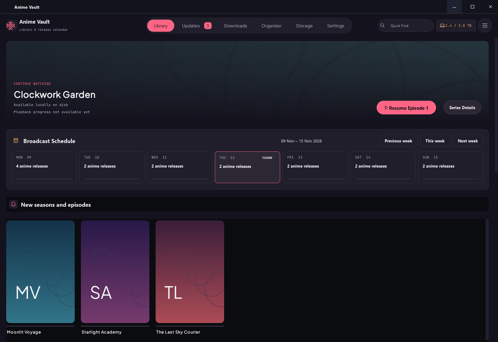
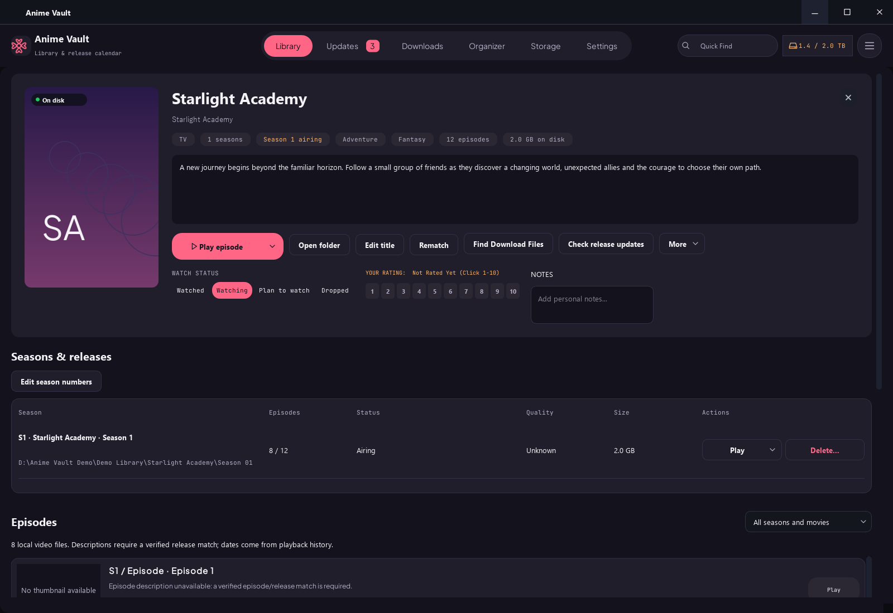
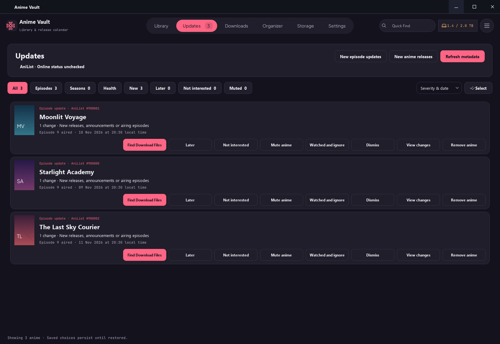
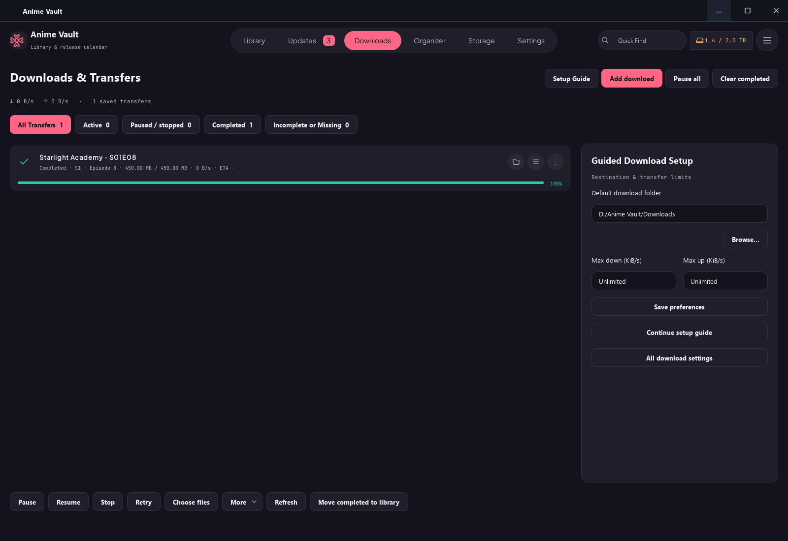
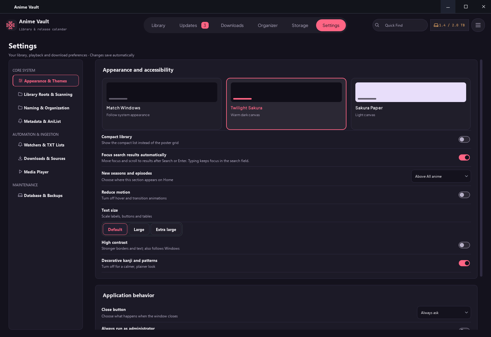
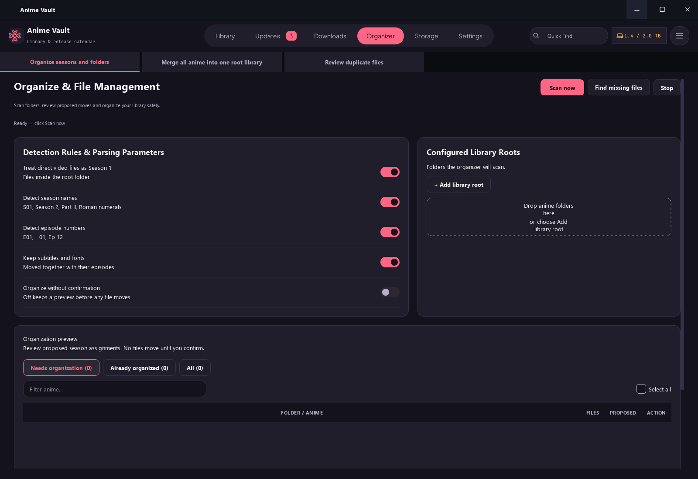

<div align="center">

# Anime Vault

### Your anime library. Your files. One desktop workspace.

A Windows anime library manager and episode tracker with AniList and Jikan metadata, a release calendar, folder organization, storage review, and built-in torrent downloads.

[](https://github.com/Agent47c/Anime-Vault/actions/workflows/checks.yml)


[Getting started](#getting-started) · [Features](#features) · [Screenshots](#screenshots) · [Documentation](docs/README.md) · [Report a bug](https://github.com/Agent47c/Anime-Vault/issues/new?template=bug_report.md)

</div>



**Current status:** a working source application under active development. The original **v1.0.0** tag remains the Version 1 baseline; `main` includes subsequent work. This is not a claim of a finished, production-certified installer. The [latest audit](WHOLE_APP_AUDIT_2026-11-12.md) documents known issues and the next reliability priorities.

## Why Anime Vault?

Local anime collections rarely follow one naming scheme. Seasons, arcs, movies, specials and encoder aliases can be spread across multiple drives. Anime Vault brings browsing, metadata correction, episode selection and reviewed file operations into the same desktop application.

- **Browse your own collection:** poster grid and list views, search, filters and sorting.
- **Understand what you own:** seasons and arcs, episode coverage, storage usage and missing-file review.
- **Keep context while navigating:** return to the same series or nested screen after switching tabs.
- **Choose when to go online:** separate local refresh from internet metadata sync, with cached artwork and saved release information.
- **Use the built-in downloader:** libtorrent handles transfers without requiring a separate torrent application.

## Features

| Workspace | Available capabilities |
|---|---|
| **Library** | Continue watching, cached banners and posters, responsive grid/list browsing, search, watch-status filters, ratings, notes and multi-select actions |
| **Series details** | Seasons/arcs grouped under a series, metadata and API JSON, rematching, manual season numbering, episode coverage and grouping confirmation |
| **Episodes & playback** | Episode browser, local-file availability, last-played highlighting, resume actions and external-player integration |
| **Release calendar** | Saved dated schedules, previous/current/next-week navigation, release previews and links to the relevant anime |
| **Updates & discovery** | Episode/season updates, release details, new-anime discovery, sorting, batch selection, Later, Not interested, Mute and persistent dismissal choices |
| **Downloads** | Built-in libtorrent queue, magnet/torrent submission, pause/resume/retry, transfer limits, restart recovery, custom search titles, reviewed release matching and completed-file indexing |
| **Chrome integration** | Optional website-specific source search and magnet capture, with explicit anime/release confirmation; no global magnet-handler replacement |
| **Organizer** | Explicit scans, cached previews, missing-file repair, season/folder organization, multi-root consolidation and duplicate-file review |
| **Storage** | Disk-capacity overview, large collections, watch/health information, potential reclaim and confirmed Recycle Bin removal |
| **Import & maintenance** | Watched TXT lists, title cleanup, existing-entry review, custom entries, SQLite backups/restoration and JSON/CSV metadata export |
| **Settings** | Categorized preferences, light/dark/system appearance, text scaling, accessibility options, media players, scanning and download configuration |

**Important distinctions:** repeated episode numbers are not proof of identical files; future episodes are not missing downloads. Known edge cases—including split-location season counts, confirmed download mappings and restore/shutdown coordination—are listed in the [audit](WHOLE_APP_AUDIT_2026-11-12.md). JSON/CSV metadata exports are not a replacement for a full SQLite backup.

## Screenshots

These are captures of the **running PyQt application**, rendered from an isolated fictional library. Demo titles, original abstract cover art, paths and transfer figures are illustrative. No personal watch history, provider artwork or active downloads are included.

| Series details | Updates |
|---|---|
| [](docs/screenshots/series-details.png) | [](docs/screenshots/updates.png) |

| Downloads | Settings |
|---|---|
| [](docs/screenshots/downloads.png) | [](docs/screenshots/settings.png) |

<details>
<summary>Organizer and file-management workspace</summary>



</details>

Reproduce the screenshots without accessing your real library:

```powershell
.\.venv\Scripts\python.exe scripts/capture_readme.py
```

## Getting started

### Requirements

- Windows 10 or 11, 64-bit. Other operating systems are not currently validated.
- Python **3.13**, 64-bit, and Git for a source checkout.
- An external media player: Windows default, VLC, MPV, MPC-HC, PotPlayer or a custom executable.
- Optional: FFmpeg on `PATH` for episode-frame artwork/preview extraction; Google Chrome for the selected-site extension.

### Install and launch

```powershell
git clone https://github.com/Agent47c/Anime-Vault.git
cd Anime-Vault
py -3.13 -m venv .venv
.\.venv\Scripts\python.exe -m pip install --upgrade pip
.\.venv\Scripts\python.exe -m pip install -r requirements.txt
.\.venv\Scripts\python.exe main.py
```

Using the virtual environment's Python directly avoids PowerShell activation-policy changes. Administrator mode is optional, not an installation requirement.

### First run

1. Open **Settings → Library Roots & Scanning** and add your own anime folders.
2. Run a local scan. Use internet sync when you want title matching and fresh metadata.
3. Review unresolved matches rather than assuming a weak filename match is correct.
4. Choose your media player and open a series to browse or play its episodes.
5. Before organizing a large collection, create a database backup and review the proposed file moves.

Download setup is optional. See the [current built-in download guide](docs/DOWNLOADS.md) and [Chrome extension instructions](browser-extension/README.md). Downloads use libtorrent; no qBittorrent installation or Web UI credentials are required. Only download and share material you are authorized to access.

## Data, privacy and configuration

- In a source checkout, the app keeps its local database, artwork cache and other generated state in `data/`. Your media stays in the locations you configure.
- Databases, credentials, watch lists, runtime caches, logs and downloaded media are excluded from Git. The published screenshots use a disposable demo database.
- The source currently starts an existing **local FastAPI bridge** on `127.0.0.1:8765`. It is not a cloud service. Keep it bound to loopback; optional token/Origin configuration is documented in [.env.example](.env.example). The audit records additional hardening still needed.
- No AniList-account synchronization or account-login capability is implied by metadata lookup. Cached browsing can continue when providers are unavailable; fresh metadata and source searches need connectivity.
- Copy `.env.example` to `.env` only if you need configuration overrides. Do not commit `.env` or tokens.

## Development and validation

```powershell
.\.venv\Scripts\python.exe -m pip install -r requirements-dev.txt
.\.venv\Scripts\python.exe scripts/check.py
node --test browser-extension/tests/capture.test.js browser-extension/tests/search.test.js
```

The Python command compiles the source and runs the regression suite with temporary databases, offline metadata mode and Qt's offscreen platform. Development dependencies include HTTPX2 for Starlette's API test client; normal application use only needs `requirements.txt`. The extension tests require Node.js; CI uses Node 22.

**Latest publication validation:** 502 Python tests and 18 extension tests passed. These checks do not certify real-drive power-loss recovery, every DPI/theme combination or a clean-machine installer.

The same validation runs in [GitHub Actions](https://github.com/Agent47c/Anime-Vault/actions). An optional local guard is included:

```powershell
git config core.hooksPath .githooks
```

See [CONTRIBUTING.md](CONTRIBUTING.md) for the development workflow and [SECURITY.md](SECURITY.md) for security reporting. Do not move the original `v1.0.0` tag or force-push shared history.

### Project layout

```text
app/
  core/                 Scanning, identity, artwork, releases and transfers
  ui/                   PyQt pages, reusable components and navigation
  api/                  Existing local FastAPI bridge
browser-extension/      Optional selected-site Chrome integration and tests
assets/fonts/           Bundled fonts and their license notices
tests/                  Python regression and integration tests
scripts/                Validation, profiling and demo screenshot tools
docs/                   Guides, screenshots and repository-discovery metadata
third_party/            Third-party notices
```

HTML/screenshot design-reference folders are retained in the repository. They are design inputs; the Python desktop app does not require a browser frontend or a Node build to run.

### Windows packaging

`build_exe.py` is the existing PyInstaller packaging entry point. A clean-machine-tested installer is not supplied by this update. Building, signing, upgrade testing and final distribution remain separate release work.

## Documentation and reliability roadmap

- [Documentation index](docs/README.md)
- [Complete feature and navigation map](All%20Feature%20and%20their%20Navigation.md)
- [Changelog](CHANGELOG.md)
- [Current whole-app audit and prioritized findings](WHOLE_APP_AUDIT_2026-11-12.md)
- [Stable identities and recoverable file operations](PHASE_1_DATA_SAFETY.md)
- [Incremental scanning, persistent matching and artwork caching](PHASE_2_TRUSTWORTHY_SCANNING.md)
- [Organizer usage](ORGANIZER_USAGE.md)

Next reliability priorities are save durability, verified download mappings, coordinated database restoration, API boundary hardening and correct aggregation when one season is scattered across download/library folders. Existing test coverage does not mean these pending audit findings have already been fixed.

## Dependencies and licensing

Built with Python, PyQt5/Qt, SQLite, Pillow, libtorrent, FastAPI, AniList and Jikan integrations. Bundled [font licenses](assets/fonts/) and the [libtorrent notice](third_party/libtorrent-LICENSE.txt) are retained. AniList, Jikan, media-player names and other third-party marks belong to their respective owners; this project is not endorsed by them.

No project-wide license has been selected in this repository. Public source availability alone does not grant an unrestricted reuse license. Review dependency terms and choose an appropriate project license before distributing modified code or binaries.
