<div align="center">

# Anime Vault

**A Windows desktop app for organizing, tracking, and playing your local anime collection.**

Browse your library, track episode releases, and review exactly where your files go.

[](https://github.com/Agent47c/Anime-Vault/actions/workflows/checks.yml)


[Get started](#get-started) · [Feature walkthrough](#feature-walkthrough) · [Documentation](docs/README.md) · [Changelog](CHANGELOG.md) · [Report a bug](https://github.com/Agent47c/Anime-Vault/issues/new?template=bug_report.md)

</div>


**Version 1.2.0** adds Manga Brutalism Dark, live switching between four themes, improved Organizer controls, and an About link in Settings. The changelog covers the download, discovery, backup, and theme fixes included on `main`. [View the changelog](CHANGELOG.md)

## Get started

### Windows installer

Check [GitHub Releases](https://github.com/Agent47c/Anime-Vault/releases) for published Windows installers. The setup installs the program in `C:\Program Files\Anime Vault` and keeps the installed profile in `%LOCALAPPDATA%\AnimeVault`. See the [installer guide](docs/INSTALLER_GUIDE.md) for upgrades, data locations, and restoring a backup from a source checkout.

### Run from source

Use 64-bit Python 3.13 and Git on Windows 10 or 11. The installer, when available, bundles the application’s runtime.

```powershell
git clone https://github.com/Agent47c/Anime-Vault.git
cd Anime-Vault
py -3.13 -m venv .venv
.\.venv\Scripts\python.exe -m pip install -r requirements.txt
.\.venv\Scripts\python.exe main.py
```

1. In **Settings → Library Roots**, add the folders you want Anime Vault to scan.
2. Use **Refresh local library** for files on your drive. Choose **Refresh and sync with internet** when you also want online metadata and release information.
3. Open a title to review its match, choose a media player in **Settings → Media Player**, and play an episode. You can also import a watched TXT list from the navigator.
4. Create a backup under **Settings → Database & Backups** before transferring your profile or making large changes.

## Feature walkthrough

The screenshots show the running desktop app with fictional titles, original abstract artwork, example paths, and illustrative transfer statistics. Click an image to view it at full size.

### Library and playback

- The Library has a poster grid and a compact list, with title search, sorting, watch-status filters, and multi-select actions. **Continue Watching** returns to a series and resumes playback where supported by the player.
- **Series Details** brings together descriptions, seasons and arcs, local episode coverage, ratings, and notes. You can rematch metadata, group related entries, edit seasons, or open the source folder.
- **Choose Episode** shows available local episodes and starts playback in Windows default, VLC, MPV, MPC-HC, PotPlayer, or a custom player. Playback progress and resume support vary by player.

| Browse and filter the Library | Open a title and review seasons |
| --- | --- |
| [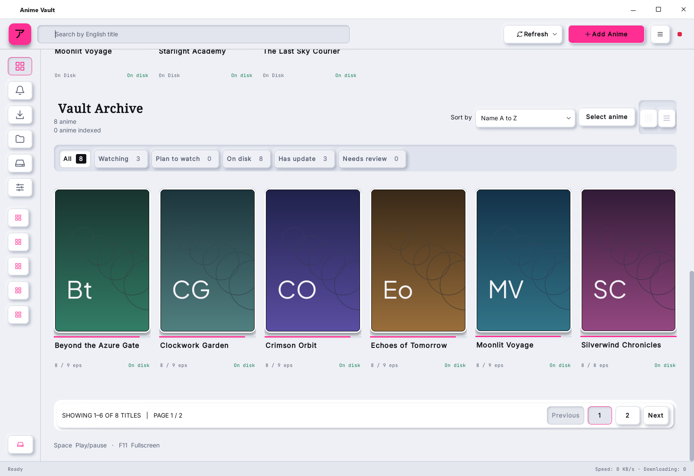](docs/screenshots/library-grid.png) | [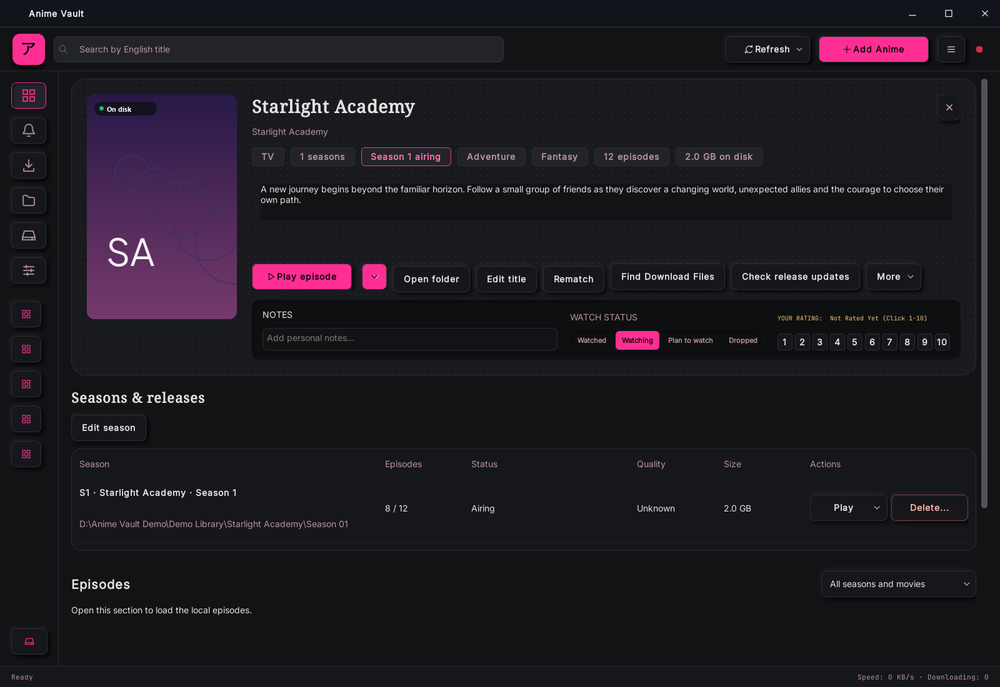](docs/screenshots/series-details.png) |

<details>
<summary>See the episode picker and Sakura Library</summary>

| Choose an episode | Sakura Dark home screen |
| --- | --- |
| [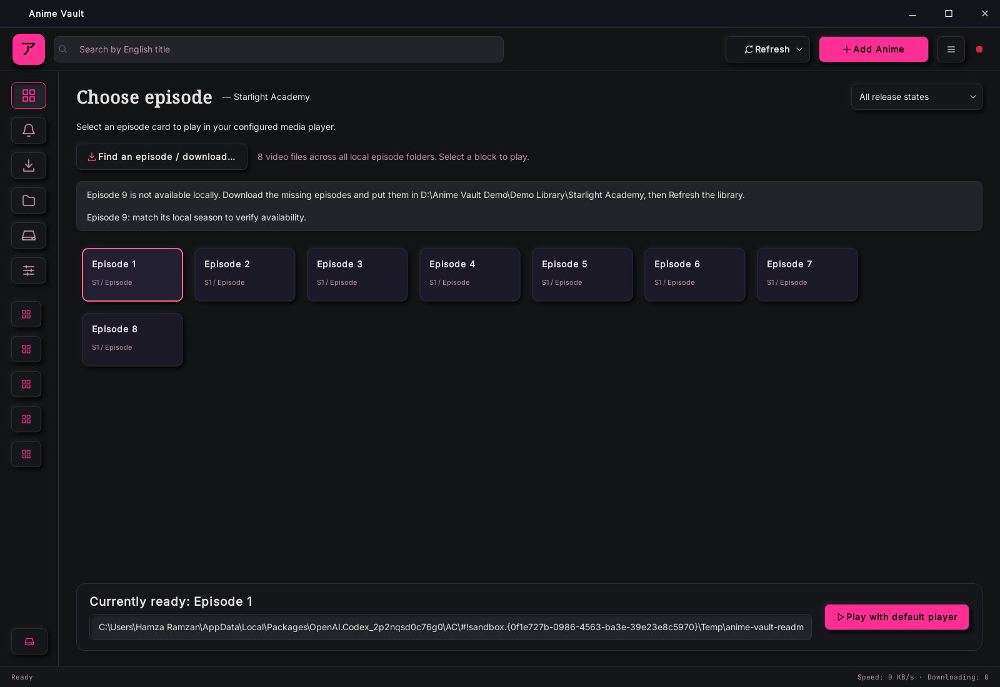](docs/screenshots/episodes.png) | [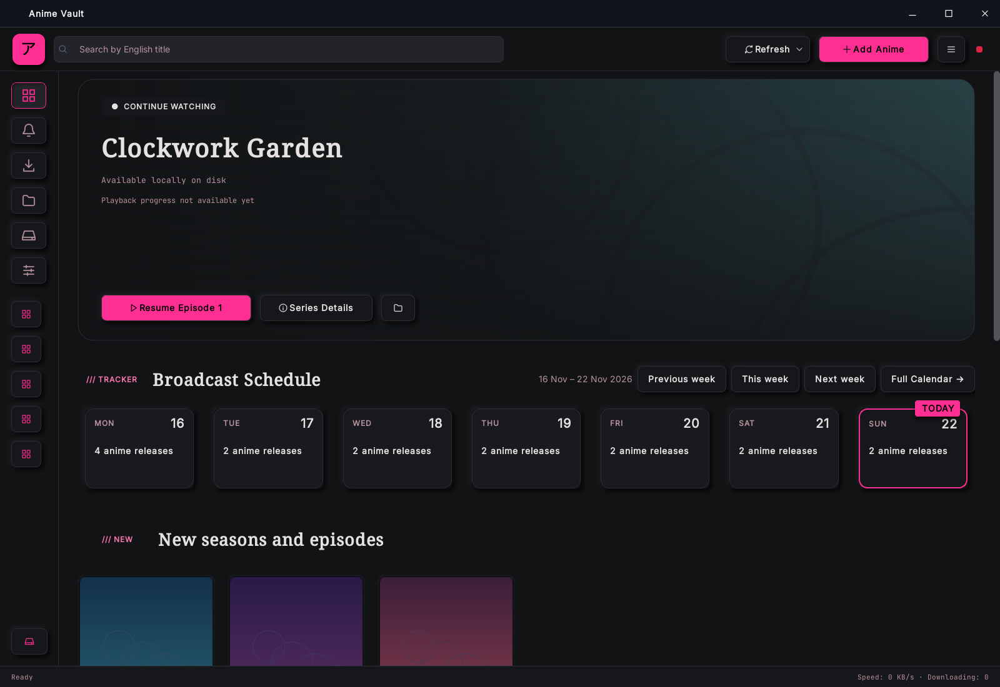](docs/screenshots/library.png) |

</details>

### Updates, release calendar, and discovery

- **Broadcast Schedule** shows the week’s saved airings in local time. Use the week buttons to browse or **Full Calendar** in Manga Brutalism for a month view.
- **Updates** surfaces episode, season, and metadata changes. **View changes** opens the saved details for that title. You can defer, dismiss, mute, or mark an update as not interested.
- **New anime releases** supports date windows, genre and theme tags, formats, and sorting. Open a release for its details or add it to your library as **Watching**. The page opens saved results when available and checks the provider when you request a refresh.

| Review library updates | Discover new anime |
| --- | --- |
| [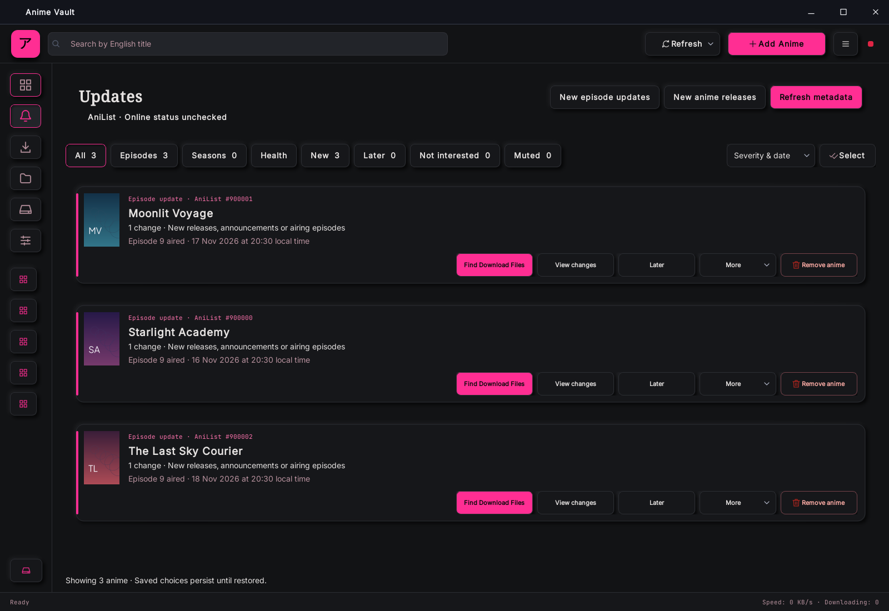](docs/screenshots/updates.png) | [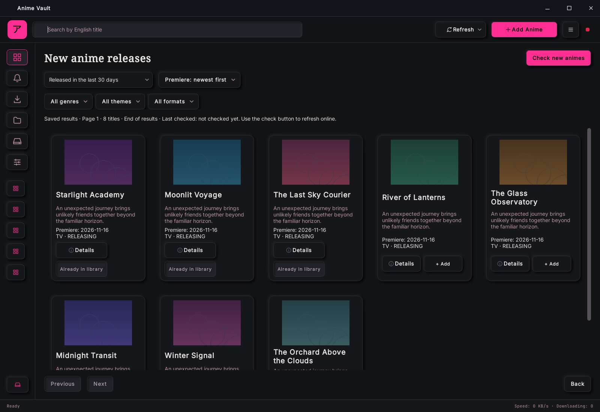](docs/screenshots/discovery.png) |

<details>
<summary>See the full broadcast calendar</summary>

[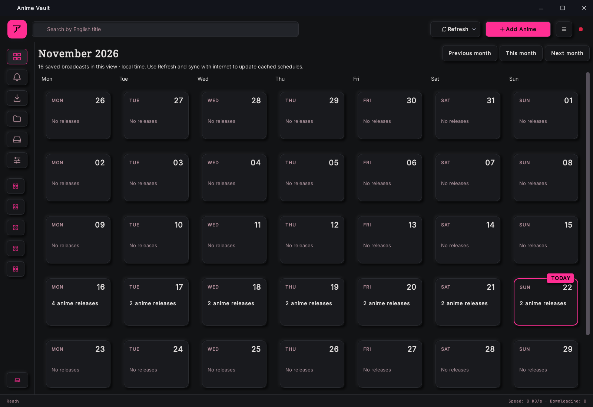](docs/screenshots/calendar.png)

</details>

### Downloads and transfers

1. Open **Downloads → Setup Guide** to choose a destination and set upload and download limits.
2. Paste a magnet or open **Find Download Files** from a title. Saved search text, alternate titles, and filters help you find the intended release.
3. Confirm the anime, season, and episode assignment before adding the download. The built-in libtorrent engine manages the queue, transfer progress, file selection, and retry.
4. After completion, **Move completed to library** gives you a preview of the proposed destination. Review it before moving the files.

The optional Chrome extension can hand off magnet links from the site you enable. Its connection indicator appears in download settings. See the [download guide](docs/DOWNLOADS.md), [workflow diagram](docs/DOWNLOAD_ORGANIZER_FLOW.md), and [Chrome setup](browser-extension/README.md).

[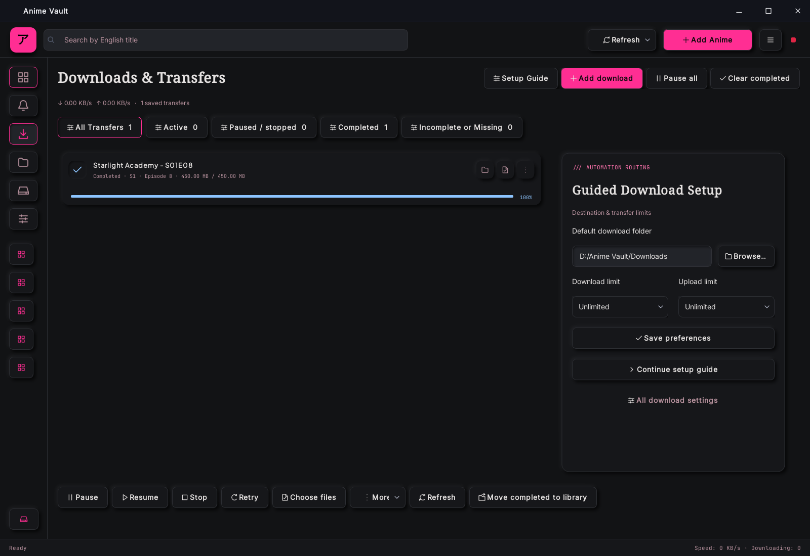](docs/screenshots/downloads.png)

### Organizer and storage

- In **Organizer**, add and review library roots, set detection rules, then use **Scan now** to generate a move preview. **Find missing files** helps investigate missing paths, and **Merge Libraries** previews consolidation into a chosen root.
- **Review duplicate files** identifies exact copies. Inspect results and select redundant copies individually, by title, or in bulk. A verified keeper is protected and recycling requires confirmation.
- **Storage** shows disk capacity, file availability, watched collections, and potential space savings. Open a collection to review its local files before taking action.

| Review proposed folder changes | Inspect verified duplicate copies |
| --- | --- |
| [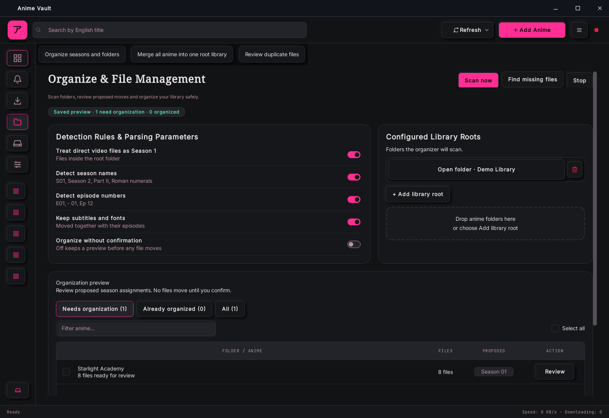](docs/screenshots/organizer.png) | [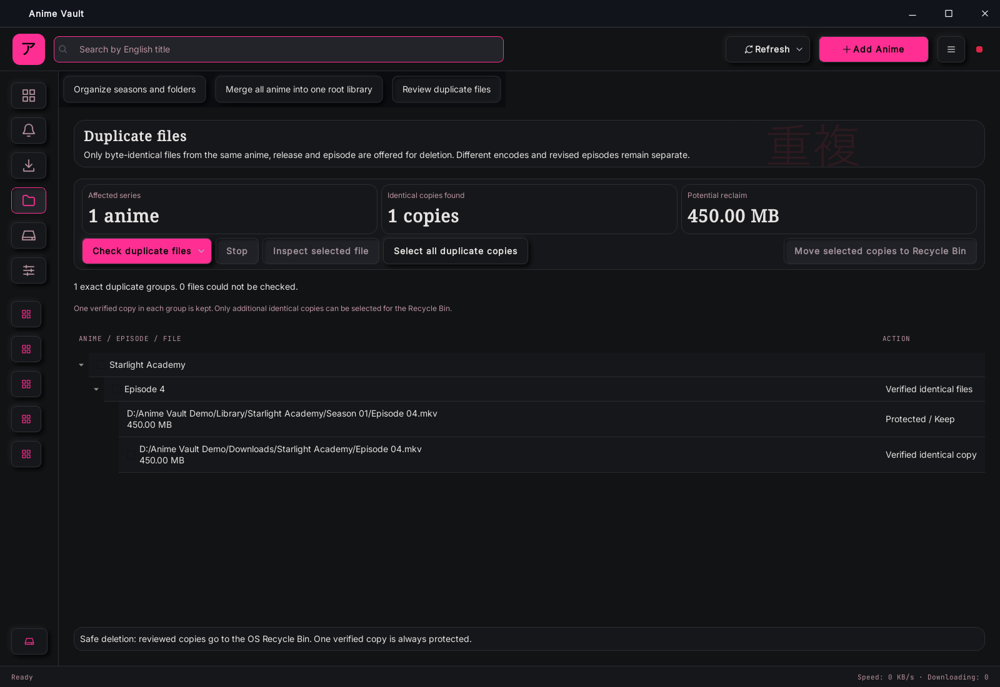](docs/screenshots/duplicate-review.png) |

<details>
<summary>See the Storage workspace</summary>

[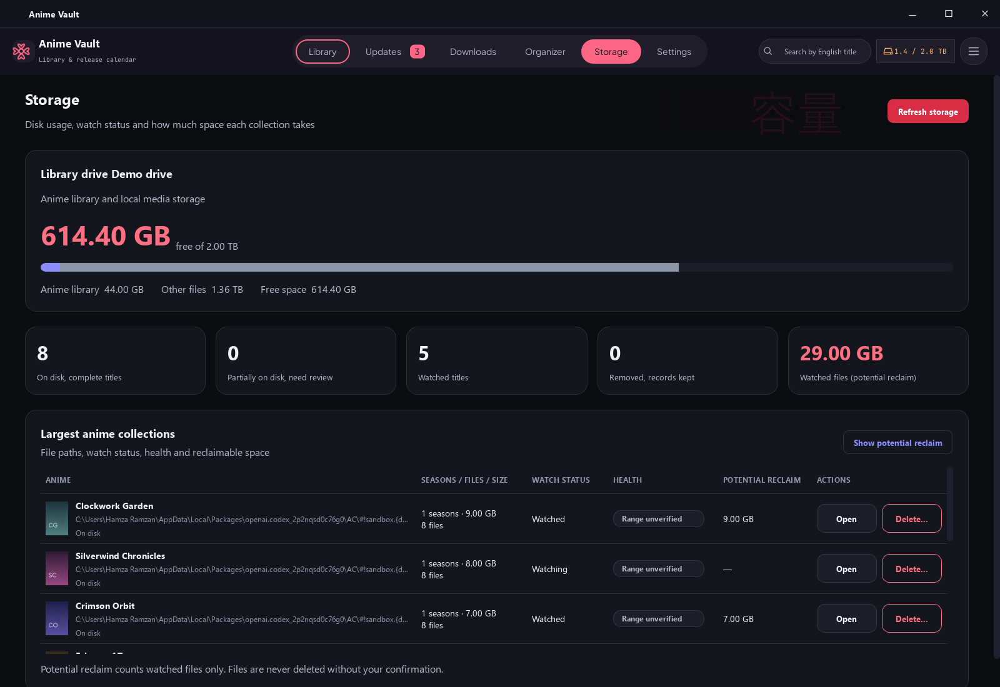](docs/screenshots/storage.png)

</details>

### Themes, accessibility, and backups

- **Appearance & Behavior** offers Sakura Dark, Sakura Light, Manga Brutalism Light, and Manga Brutalism Dark. The app applies themes live, and each preview shows where the navigation sits. Sakura Dark is the default for new profiles.
- Settings also includes text sizing, reduced motion, high contrast, search focus, metadata preferences, and optional adult access controls. **About us on GitHub** opens this repository.
- **Database & Backups** supports SQLite backups and full app-state ZIP backups with optional cached artwork. Restore accepts either backup type and prompts you to restart Anime Vault. Media files stay at their original locations. JSON and CSV exports are available for metadata.

| Preview themes and adjust accessibility | Back up or restore your profile |
| --- | --- |
| [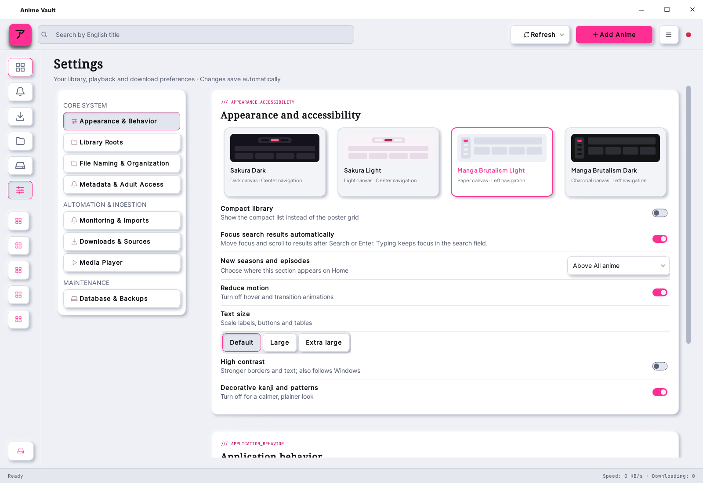](docs/screenshots/settings.png) | [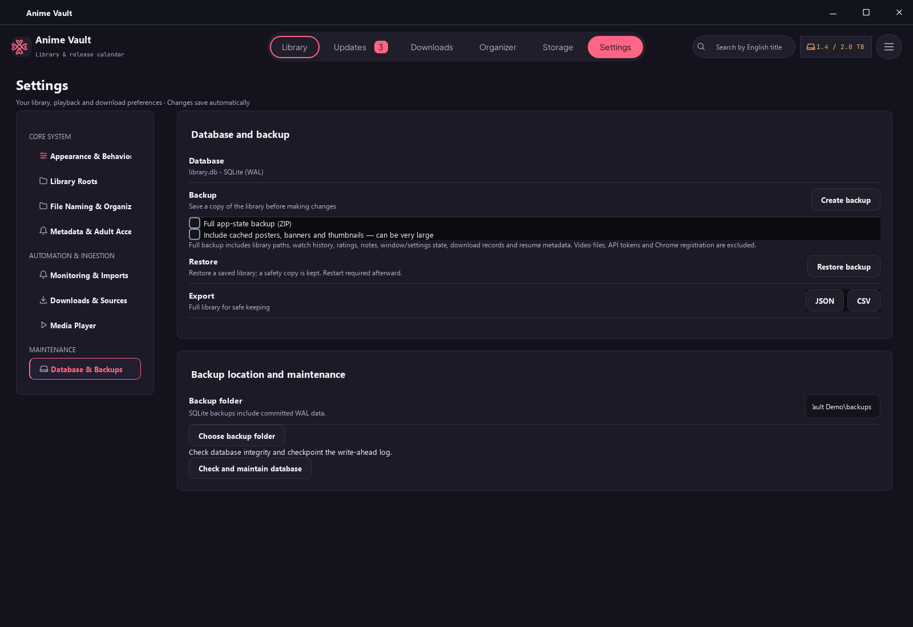](docs/screenshots/backup-and-restore.png) |

<details>
<summary>See Manga Brutalism Light</summary>

[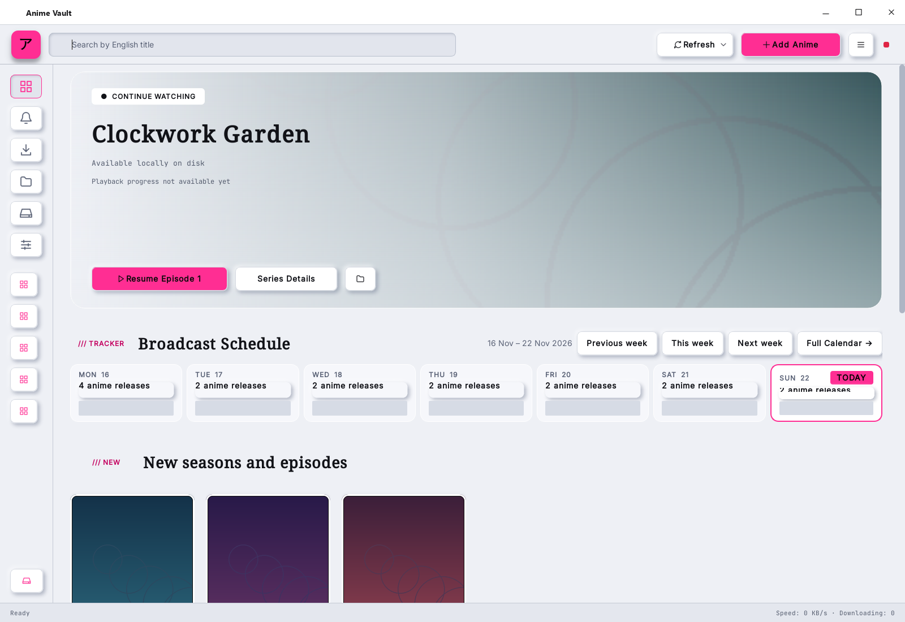](docs/screenshots/library-manga-light.png)

</details>

## Data and privacy

Anime Vault stores library records, preferences, artwork, and playback history locally. A source checkout uses `data/` by default. AniList and Jikan provide metadata, and online discovery or source search requires connectivity. The desktop app uses a loopback FastAPI service at `127.0.0.1:8765`. See [Privacy & data use](PRIVACY.md), [security reporting](SECURITY.md), and [configuration examples](.env.example).

## Development

```powershell
.\.venv\Scripts\python.exe -m pip install -r requirements-dev.txt
.\.venv\Scripts\python.exe scripts/check.py
node --test browser-extension/tests/capture.test.js browser-extension/tests/search.test.js
.\.venv\Scripts\python.exe scripts/capture_readme.py
```

The screenshot generator uses an isolated demo database and runs offline. For source layout, packaging, and additional workflows, see the [documentation index](docs/README.md), [feature and navigation map](docs/guides/All%20Feature%20and%20their%20Navigation.md), and [contributing guide](CONTRIBUTING.md).

Anime Vault uses Python, PyQt5, SQLite, Pillow, libtorrent, and FastAPI. Bundled [font licenses](assets/fonts) and the [libtorrent notice](third_party/libtorrent-LICENSE.txt) are included. A project-wide reuse license has yet to be selected.
