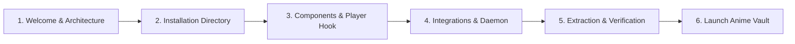

# Anime Vault — Windows Application Packaging & Installer Specification

**Application Name:** Anime Vault  
**Executable:** `AnimeVault.exe`  
**Package Target:** Windows 10 / Windows 11 (x64, ARM64)  
**Installers:** Inno Setup (.exe), MSIX Package (.appx / .msix), Portable Zip (`AnimeVault-Portable.zip`)  
**Theme:** Twilight Sakura Dark (`#14121d` obsidian velvet, `#ff5376` sunset sakura coral)

---

## 1. Windows Application Identity & Metadata
- **AppId:** `AnimeVault.Desktop.MediaManager`
- **Publisher:** `Anime Vault Open Source Project`
- **Publisher Display Name:** `Anime Vault Foundation`
- **Version:** `2.4.1.0`
- **Default Install Directory:** `%LOCALAPPDATA%\Programs\AnimeVault` (per-user non-elevated) or `C:\Program Files\AnimeVault` (system-wide admin)
- **Data & Database Directory:** `%APPDATA%\AnimeVault` (`library.db`, `config.json`, logs, thumbnails cache)
- **Default Downloads Directory:** `E:\Anime Library\.animevault-downloads` (configurable in wizard)
- **Protocol Handlers Registered:**
  - `magnet:` (Optional prompt during setup)
  - `animevault://` (Internal deep linking for browser extension & automation)
- **File Associations Registered:**
  - `.torrent` (BitTorrent Seed File)
  - `.mkv`, `.mp4` (Optional contextual open with Anime Vault File Inspector)

---

## 2. Icon & Graphic Asset Inventory (`.ico` & Branding)

| Asset File | Target Sizes / Resolution | Description & Target Usage |
| :--- | :--- | :--- |
| `AnimeVault.ico` | Multi-size: 16x16, 24x24, 32x32, 48x48, 64x64, 128x128, 256x256 | Master application icon for `.exe` resource, desktop shortcut, taskbar icon. |
| `TrayIcon.ico` | 16x16, 32x32 (100% & 200% DPI) | Windows system tray notification area icon (with active/transfer state rings). |
| `AppListEntry_44x44.png` | 44x44 (100%), 66x66 (150%), 88x88 (200%) | Windows Start Menu compact tile & App list icon. |
| `AppListEntry_150x150.png` | 150x150 (100%), 300x300 (200%) | Windows Medium Start Menu live tile asset. |
| `PackageLogo_50x50.png` | 50x50 | Microsoft Store / Windows Settings "Installed Apps" list icon. |
| `SetupHeader_500x120.png` | 500x120 banner | Inno Setup / NSIS modern installer top title banner. |
| `SetupSidebar_164x314.png` | 164x314 left artwork | Traditional Windows setup wizard left splash branding. |

---

## 3. Installer Architecture & Setup Flow

The installation package includes a **5-step modern setup wizard** matching the Twilight Sakura design language:

### Components Selectable During Setup:
1. **Core Application Files:** `AnimeVault.exe`, PyQt6 runtime, Python backend runtime, SQLite engine.
2. **Built-in Torrent Daemon:** High-performance local libtorrent / transmission daemon backend.
3. **Chrome / Chromium Native Companion Host:** Native messaging manifest allowing Chrome extension to pipe magnet links directly to Anime Vault.
4. **Media Player IPC Bridge:** CLI hooks and detection for MPV, VLC, and MPC-HC.
5. **Desktop & System Tray Shortcuts:** Quick launch and background daemon resident mode.