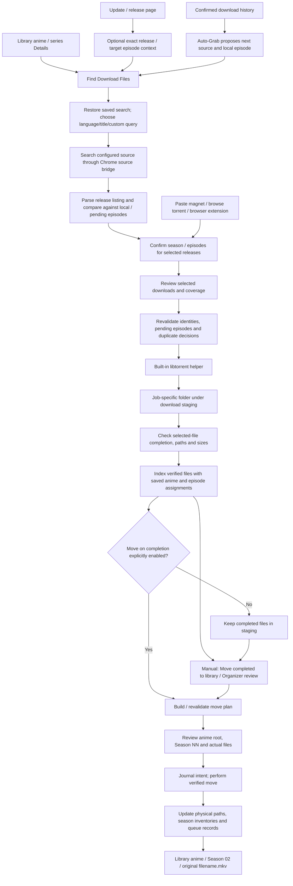
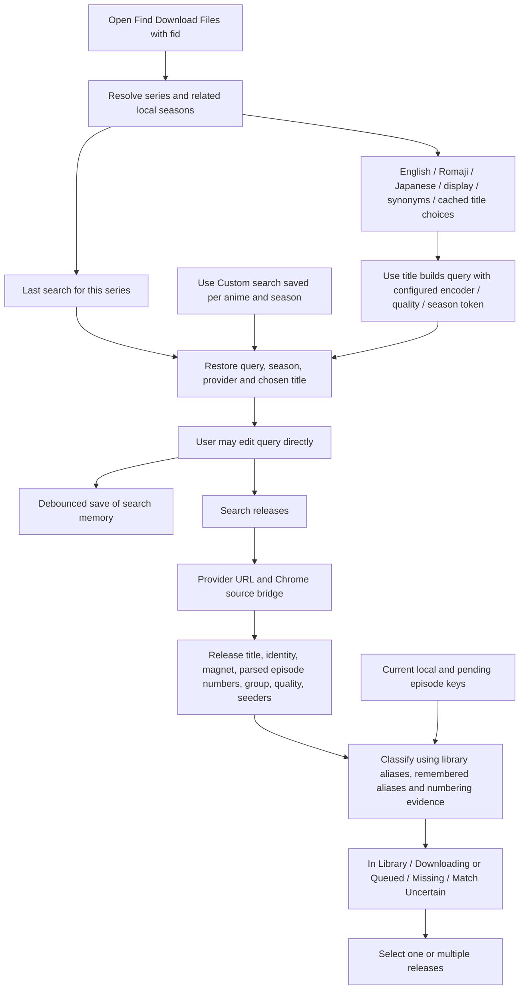
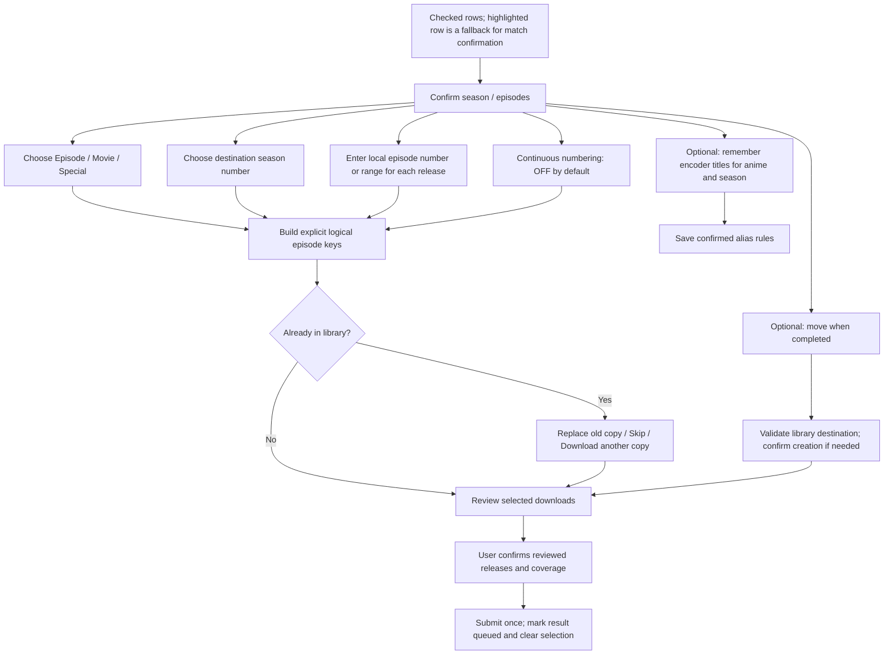
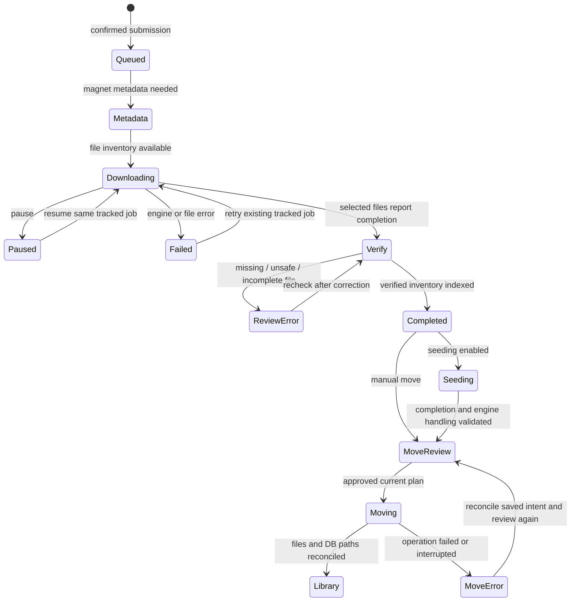
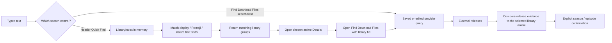
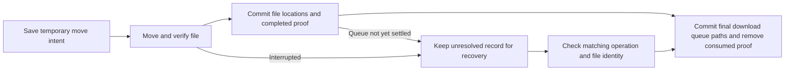

# Downloads and Organizer: current flow

## The three folder roles

| Role | Example | Purpose |
| --- | --- | --- |
| Main library root | `E:\Anime Library` | Parent folder containing the anime library |
| Download staging base | `E:\Anime Library\.animevault-downloads` | Temporary home of tracked torrent jobs; may instead be a separately configured folder |
| Anime/season destination | `E:\Anime Library\Black Clover\Season 01` | Final library location of a reviewed completed download |

Watched folders tell the scanner where to look. Several watched folders can
belong to one main library. They are not automatically separate destinations.

## Download stages

1. **Find Download Files:** search the configured source using the editable title.
   Searching only reads listings; it does not start a transfer.
2. **Confirm assignment:** link each selected release to the anime, its season
   folder and episode numbers. Continuous numbering and physical destination
   are independent. Episode 177 remains 177 unless the user edits it.
3. **Review and submit:** review the coverage/destination, confirm, and submit to
   the built-in libtorrent engine. Duplicate torrent identities and overlapping
   pending episodes are checked. Normal confirmed submission does not require
   another Choose Files step.
4. **Transfer:** download into an isolated per-job subfolder under staging.
   Isolation avoids different jobs writing into the same active directory.
5. **Complete and index:** verify the selected files' completion, paths and sizes,
   then record local videos against the linked anime. Completed means downloaded;
   it does not mean moved into the final library folder.
6. **Move to library:** Downloads > Move completed to library or Organizer's
   completed-download Review opens the source/destination preview. Only the
   explicit Move action relocates files.

Example:

```text
Before reviewed move:
E:\Anime Library\.animevault-downloads\Black Clover-<job-id>\Season 01\177.mkv

After reviewed move:
E:\Anime Library\Black Clover\Season 1\177.mkv
```

The original torrent filename is retained; `177.mkv` is illustrative. A unique
existing season folder is reused even before it is indexed. If several folders
match, the app requests review. It does not invent a season boundary or numbering
offset from folder names.

## Organizer stages

1. Scan configured watched folders and known anime locations.
2. Index discovered local files and prepare proposed season/folder assignments.
   Scanning updates inventory; it does not authorize physical file moves.
3. Treat known torrent staging as staging. Completed jobs use their saved anime
   identity instead of treating the staging folder itself as a new anime.
4. Show the proposals. Items are no longer automatically selected after scans
   or filter changes. Review lets the user examine an individual proposal.
5. For completed torrents, revalidate files and show the move-to-library preview.
   For ordinary folder organization, reject stale plans until scanned again.
6. On explicit confirmation, run the move worker with collision checks and a
   recovery journal. Do not overwrite an existing destination file. Keep file
   identity/history and database paths aligned with completed operations.

Files with unknown anime identity require review. Similar names alone are not
enough to move arbitrary videos into an anime's folder.

## Bugs identified in the root/folder flow

- The Merge destination could be shown without being saved. It used to be saved
  only when a preview finished. Completed-download review therefore could not
  see the choice. The destination is now saved immediately on selection or
  completion of editing.
- Main-root detection required exactly one watched-directory row. A main folder
  plus nested watched anime/staging folders could therefore be considered
  ambiguous. Nested watched folders are now collapsed; genuinely separate roots
  still require a main-root choice.
- A generic Open download folder action followed the selected transfer. Selecting
  Black Clover could open Black Clover's job folder, making it appear that the
  shared folder had changed. Opening a folder does not rename it. The global and
  selected-transfer actions now have separate explicit labels/routes.
- Saved default download paths could be replaced by an automatically derived
  path. An explicitly saved destination is now preserved.
- An unindexed `Season 1` could be overlooked and a new `Season 01` proposed.
  Preview now reuses the unique matching physical folder.
- Stale Organizer previews disabled completed-download Review even though that
  action performs its own fresh validation. That review route now remains usable.
- A first completed download can temporarily be the anime's only local location.
  A later move preview could mistake that staging location for the canonical anime
  folder, especially with a custom staging-directory name or another job folder.
  Preview now excludes the configured staging base and all tracked job roots when
  choosing an existing final anime/season folder. It also rejects targets inside
  staging rather than sending files from one torrent job into another.

Main library selection, staging configuration and per-anime file locations are
separate settings. Choosing one or opening a folder never moves files by itself.

# Detailed search, download and library-move map — 21 November 2026

This section describes the current source, including the local 1.1.2 changes.
A diagram arrow means a call or data handoff, not permission to move a file.
Existing files and database records were not modified to prepare this map.

## 1. End-to-end overview



## 2. Searching does not decide the anime identity

The page is opened with a library `fid` (series/anime ID). A release title is
compared against that selected anime; it does not silently create a new anime
because an encoder uses another title. A title is search/matching evidence.
The confirmed library ID and episode assignment are the ownership decision.



- Search text is editable and can differ from the library display title.
- Editing a generated query now also saves it as the selected Custom search for
  this anime and season. The separate series search memory retains the latest
  query, provider and season, so reopening restores the exact previous form.
- Last search memory is scoped to the resolved series ID. Its stored record
  contains the query, season, provider and chosen title. It is not a separate
  saved search for every season: changing seasons updates that series record.
- Custom queries and remembered encoder aliases have season-aware keys.
- Choosing a title can regenerate the query. Editing a query and saving an
  encoder alias are separate operations; neither automatically renames a library
  anime or a video file.
- Search listings, seed counts and parsed filenames do not establish that a file
  is downloaded, complete or correctly assigned.

## 3. Confirmation and episode mapping



Example: the original encoder file can contain episode **177**, while the user
attaches it to **Season 02, episode 7**. The database stores the logical mapping;
the original filename remains unchanged. Remembering a title alias is different
from learning the source-to-local episode numbering relationship.

Auto-Grab reads confirmed job/history mappings and proposes the next source/local
numbers. It opens confirmation; it does not gain permission to download or move
an arbitrary next release without review.

## 4. Download states and the completion boundary



These are conceptual states: exact queue labels and persisted engine fields are
not identical. `indexed` means verified file ownership was recorded; it does not
necessarily mean the file has reached its final library folder. Likewise,
`desired=cancelled` is also used for finalized moved jobs, so that flag alone is
not proof that a download was unsuccessful.

Torrent allocation may create a full-size partial file before downloading is
complete. Move eligibility uses verified completion/inventory and queue intent,
not simply the existence or apparent size of a staging file.

## 5. Moving completed downloads

```mermaid
sequenceDiagram
    actor User
    participant UI as Downloads / Organizer
    participant Plan as download_library.preview
    participant DB as SQLite and saved job state
    participant Engine as Torrent helper
    participant Ops as file_operations
    participant FS as Filesystem
    User->>UI: Move completed to library
    UI->>Plan: Request fresh preview
    Plan->>DB: Read job ownership, verified files and main root
    Plan->>FS: Validate source and destination boundaries
    Plan-->>UI: Concrete source-to-target rows or reason unavailable
    User->>UI: Confirm reviewed move
    UI->>DB: Save library_move_intent before moving
    UI->>Engine: Detach/remove appropriate tracked transfer without deleting files
    loop Each reviewed file
        UI->>Ops: Move with expected file signature
        Ops->>DB: Commit durable operation intent
        Ops->>FS: Rename without overwrite, or verified copy across volumes
        Ops->>DB: Relocate identity and compatibility references
        UI->>DB: Persist updated verified-file path
    end
    UI->>DB: Settle season folder and anime library root
    opt Explicitly approved replacement
        UI->>Ops: Recycle old copy only after new target is verified
    end
    UI->>DB: Mark library_moved; clear completed move intent
    UI-->>User: Moved / reconciled / failed counts
```

The base download folder, a selected torrent's own job folder, the main library
root and an anime's season folder have distinct roles. Opening a folder changes
none of those roles. A preview must never choose another staging job as the anime
root. Season destinations are canonically named `Season 01`, `Season 02`, etc.

On interruption, a durable move intent and `file_operations` journal are used to
reconcile proven results. Matching a filename or finding another same-size video
is not sufficient proof that a particular completed download was moved there.

## 6. Where the state lives

| State | Current storage / owner | Meaning |
| --- | --- | --- |
| Anime identity, titles, metadata, status | `franchises` and series grouping | The library object selected by the user |
| Local release / season inventory | `seasons` | Release, season folder, local inventory and metadata |
| Physical file identity / location | `physical_files`, `file_locations` | Actual file and normalized current path |
| Logical episode ownership | `episodes`, `file_episodes` | Verified release numbering independent of filename |
| Queue records | `app_state` key `downloads.jobs` | Source identity, destination, selected files, verification, mapping and move state |
| Last search | `download_search_memory:{series_id}` | Latest series search form, including selected season/provider |
| Custom search | `download_custom_query:{series_id}:{season}` | Optional custom query and its active state |
| Encoder alias | `download_aliases:{series_id}:{season}` and confirmed alias rules | Names accepted for the selected anime/season |
| Confirmed download history | `download.confirmed_history:{fid}` | Recent confirmed mappings used for next-episode suggestions |
| Move/recycle intent | `file_operations` and job `library_move_intent` | Recovery evidence; not a fresh move authorization |
| Posters and metadata caches | Data/cache directories and saved metadata | Presentation resources, not file ownership evidence |

The persistent SQLite database remains authoritative. The retained in-memory
snapshot accelerates presentation; it must be replaced or synchronized after
committed changes. Restoring a backup requires a fresh process so old snapshots,
widgets and image caches do not continue representing the previous database.

## 7. Local 1.1.2 review points before the lightweight follow-up

1. `download_queue.check_completed_files()` currently accepts a saved move target
   by existence and matching size when the old source is missing. It should require
   the journal's completed-operation/identity evidence before adopting that target.
2. `identity.relocate()` now retires an existing target location record to avoid a
   UNIQUE collision. Its caller must prove that record is obsolete/replaced; an
   unrelated live target must remain a collision, not disappear from ownership.
3. Errors should distinguish **waiting for completion**, **no verified inventory**,
   **main-root ambiguity**, **already moved**, **destination collision** and
   **replacement cleanup failed**, with a concrete next action for each.
4. Preview, completion indexing and final move all need to agree on the same anime,
   local season and episode keys. Search string changes should never silently
   change confirmed ownership.
5. Preserve reviewed manual movement by default. Any auto-move remains explicit
   and must use the same validation/journal path, not an independent shortcut.

These are review findings and suggested next refinements, not changes applied to
personal files during this task. No new episode-number migrations were performed.
The later implementation in section 11 resolves the size-only recovery issue;
the other architectural recommendations remain proposals.

## 8. Source map for debugging

- `app/core/download_queries.py`: search memory, title options and custom queries.
- `app/ui/pages/release_search_page.py`: form, results, confirmation and review.
- `app/core/download_discovery.py`: local context, classification and submission.
- `app/core/download_assignment.py`: confirmed mappings, destination and next search.
- `app/core/downloads.py` and `builtin_torrents.py`: queue and engine operations.
- `app/core/download_inventory.py`: staging readiness and ownership classification.
- `app/core/download_library.py`: reviewed move preview and execution.
- `app/core/file_operations.py` and `identity.py`: durable IO and path reconciliation.

## 9. The two searches are deliberately different today

| Question | Library Quick Find | Find Download Files |
| --- | --- | --- |
| What is searched? | Loaded library records | External source listings |
| Input fields used | `display_title`, `title_romaji`, `title_native`, case-insensitive substring | Editable query; title options; custom query; encoder/group/quality/season tokens |
| Reads the torrent provider? | No | Yes, when searching releases |
| Searches remembered encoder aliases? | Not currently as independent Quick Find fields | Uses aliases as match evidence for the selected anime/season |
| Does a custom query rename the anime? | No | No |
| Starts a download? | No | Only after confirmation and review |
| Changes a physical folder? | No | Only the later reviewed move can do so |



Therefore a title saved only as an encoder alias can help release matching without
making that same text searchable in Library Quick Find. Adding those aliases to
the local search index would be a separate behavior change to agree on.

Series grouping also needs care: search/custom-title keys use the resolved series
ID, while confirmed-download history uses the supplied download `fid`. A future
refinement should make that ownership relationship explicit for grouped releases,
without silently moving a download to another anime because two titles resemble
each other.

## 10. Reliability review and recommended implementation order

Reviewed against the current source on 21 November 2026. This is a proposal;
no download behavior, personal database records or media were changed for this
review. Two failure cases were reproduced using temporary files and stubbed engine
submission; the other findings below come from tracing the source.

### A. Fix recovery evidence first — high priority, reproduced

`download_queue.check_completed_files()` adopts a move-intent target when the
source is absent and the target has the recorded size. A temporary unrelated
same-size file was accepted and `integrity_missing` became false, without any
completed journal record. The actual move preview has stronger checks, so this
does not demonstrate a filesystem overwrite; it demonstrates contradictory and
incorrect ownership/readiness information.

Use a common recovery-proof function in the queue and move preview. Require the
matching completed operation and its identity evidence. If proof is absent,
preserve both records and show Needs location review. For completed cross-volume
operations, retain/validate destination identity as well: `_finished()` currently
checks only original size/mtime for COPY_MOVE, although copy-time verification
already records a digest. This proposal does not add a checksum UI or require
rehashing the library on every refresh.

Acceptance: missing source plus unrelated same-size target never marks a job
healthy; proven interrupted moves reconcile once; contradictory evidence remains
reviewable and never grants permission to overwrite or recycle a file.

### B. Handle partial batch submission — high priority, reproduced

`download_discovery.submit()` validates initial coverage, then submits each entry
sequentially. If the second submission raises, the first remains accepted but the
UI receives an error instead of a per-entry outcome. A stubbed first success and
second failure reproduced that behavior. `_add_builtin()` also deliberately saves
an entry before native attachment, so a failed attach may leave a retryable row.

Prevalidate the entire batch, reserve its identities/episodes transactionally,
then dispatch entries with durable per-entry results: added, already tracked,
failed/retryable, or not attempted. Mark successful results queued immediately;
retry only failed entries and reuse any pre-existing failed attachment record.
Do not pretend the torrent engine participates in a SQLite transaction or undo
an already-running transfer just because another entry failed.

Acceptance: failure on entry 2 leaves entry 1 visibly added; repeated submission
does not create another entry; interruption after reservation/attachment is
recoverable without losing the selected coverage.

### C. Protect target ownership — high priority, source finding

`identity.relocate()` marks another file record REPLACED and removes its location
when the normalized target key is occupied. The lower-level move code already
blocks filesystem overwrites, but the database collision handler needs its own
proof that the old location is obsolete or explicitly approved for replacement.

Acceptance: an unrelated live file/location remains protected; proven stale
records can be reconciled; episode history and saved playback follow the correct
physical file through normal moves and recovery.

### D. Use one explicit ownership reference — next priority, source finding

Search/custom-query keys resolve the displayed group ID. Native job ownership
and confirmed history use the supplied franchise ID; a `library_series.id` is
also stored separately. Several duplicate guards compare the raw `fid`, while
search context expands group members. Ordinary submissions have rechecks, but
these differing scopes complicate grouping and concurrent submissions.

Define separate named fields for displayed group, owning library series, release,
local season, logical episode keys and source episode numbers. Normalize them at
every entry route and reserve equivalent logical coverage using the owning release.
Do not equate a UI group with permission to move episodes between its releases.
Keep existing IDs/mappings intact; any storage transition needs an explicit,
backward-compatible plan rather than guessed episode renumbering.

Acceptance: opening the same release through a grouped card, Updates or a pasted
magnet finds the same confirmed ownership/history and cannot concurrently reserve
the same episode without the explicit another-copy decision.

### E. Share parsing and improve next-episode suggestions — next priority

`classify()` now handles spaced S/E tokens; `next_search()` still uses its own
stricter `E`-immediately-followed-by-digits pattern. Next-search also selects the
newest creation timestamp across jobs/history, rather than comparing existing
and pending coverage for the chosen release/encoder. A later-added older episode
or cancelled historical entry can therefore produce an unhelpful next suggestion.

Use one parser result containing title evidence, encoder, source season, source
episode/range and confidence. Keep that evidence separate from user-confirmed
local season/episodes. Build suggestions from the selected confirmed mapping and
check local/pending coverage before proposing them. Continue to require the
existing confirmation; do not reinstate automatic Download Missing behavior.

Acceptance: S02E08, S02 E08 and Season 02 Episode 08 agree throughout the workflow;
source episode 177 may remain named 177 while mapping to local S02E07; a title
alias alone never grants an unverified offset or changes another encoder's mapping.

### F. Separate transfer, file and library states — staged architecture improvement

Queue state currently combines status strings with desired/indexed/library_moved,
integrity flags and move intent. `desired=cancelled` can describe a finalized move,
and public Completed can coexist with an unresolved location. Centralize allowed
transitions and derive UI labels from separate engine, verification and library
placement states. Keep the existing durable file-operation journal.

Longer term, transactional job/file rows in the existing SQLite database would
support per-job updates and uniqueness constraints better than replacing the whole
`downloads.jobs` JSON value. Multiple independent databases are not necessary.
This is a staged refactor recommendation, not a demand to migrate current data now.

### G. Improve search failure feedback — optional user-facing improvement

The provider bridge can wait up to 65 seconds per request. Show whether it is
waiting for Chrome, browser verification, provider results or local classification.
Optionally retain last successful provider/query results with a visible timestamp
on failure; always reclassify them against current local/pending episodes. Cached
seed counts and titles must not imply current availability or download completion.

Search caching would be a new feature to approve before implementation. Existing
saved query text and remembered aliases are not the same as cached search results.

### H. Keep incomplete-file protection scoped to files — next priority

The current duplicate scanner skips paths underneath an unfinished job's entire
destination directory. This protects torrent chunks, but if a legacy/shared
destination contains unrelated completed files, those neighbours are also skipped.
The scan does not currently explain that skipped scope in its final counts.

Use tracked ownership plus the selected-file inventory/readiness to defer only
unfinished or moving files. Continue checking unrelated files in the same folder,
and report scanned, deferred and unavailable counts separately. This follows the
existing requirement to avoid a broad download-folder exclusion rule.

Acceptance: one active torrent in a shared folder does not hide completed duplicate
copies beside it; torrent chunks and in-progress move targets remain unselectable.

### Proposed delivery sequence

1. Recovery proof, target-ownership checks and explicit partial-submission outcomes.
2. Shared ownership/parser contracts and consistent remembered-mapping lookup.
3. Better state transitions, file-scoped scan protection, actionable move-readiness
   reasons and search stages.
4. Optional result caching and a separately planned queue-storage refactor.

Validate each stage with temporary-data failure tests: duplicate clicks, attachment
failure halfway through a batch, restart after native attachment, shutdown during
move, stale preview, same-size wrong target, destination collision, unplugged drive,
grouped-series entry routes and a fresh episode after a remembered mapping. Passing
the current regression suite is useful evidence, not a guarantee against these
previously uncovered cases.

## 11. Implemented lightweight follow-up

The approved follow-up reuses `file_operations`, which already records source,
target, start/update timestamps, status and the source file signature. No new
temporary column or table is necessary.



Queue recovery and move previews share the same proof check. A file's size alone
does not authorize adoption. Normal checks compare filesystem metadata; they do
not calculate another video checksum. Completed COPY_MOVE records now also retain
the actual target signature, because a copied file has a different filesystem
identity from its original. The existing content verification during cross-drive
copying and interrupted-copy recovery remains unchanged.

For a completed download-library move, the queue acknowledgement and deletion of
consumed operation records happen in one SQLite transaction. Pending/error records
and records another active move still needs are retained. Existing unrelated
operation history is not bulk-deleted by this change.

The source parser now shares common explicit season/episode notation between
matching and next-search generation: S02E08, S2 E8, S 02 E 08, S-02 E-08,
S_02_E_08 and Season 2 Episode 08. This is evidence parsing, not automatic migration
or permission to rename files. Previously confirmed mappings still determine the
destination season and logical episode number.

The larger batch-submission, target-collision ownership and queue-schema proposals
in section 10 are not part of this focused follow-up.
